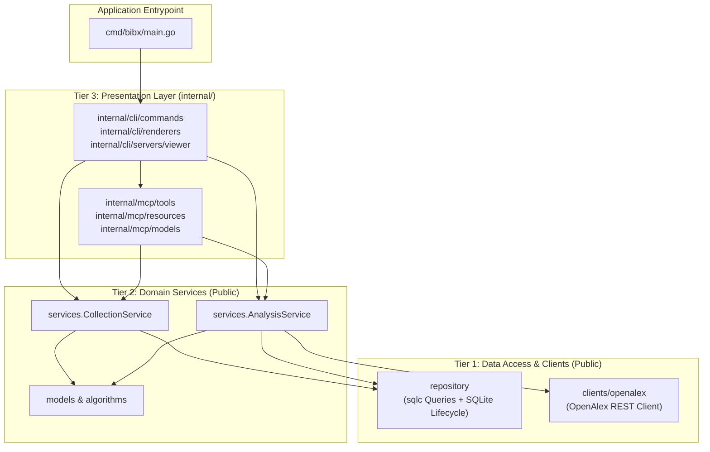

# ADR-001: Adopting a Three-Tier Architecture

## Status

Accepted

## Context

The `go-bibx` project originally evolved as a single-binary CLI tool for bibliometric data collection, network analysis (Tree of Science / SAP, Leiden community detection), and semantic search. Over time, the codebase accumulated several architectural inconsistencies:

1. **Mixed Presentation and Business Logic Boundaries**:
   With the introduction of the Model Context Protocol (MCP) server, `go-bibx` became a dual-delivery application (CLI tool and MCP server daemon). However, packages like `cli/clients/openalex` and `cli/services` were housed under `cli/`, forcing `mcp/` to import directly from `cli/` packages.
2. **Redundant Persistence Abstraction**:
   Persistence was divided across `repository/` (`sqlc`-generated queries) and `storage/` (`storage.Store` interface and `storage.SQLiteStore` implementation), creating redundant interface layers and entity-to-model translation boilerplate.
3. **Public Exposure of Internal Delivery Entrypoints**:
   Presentation packages (`cli/` and `mcp/`) were exposed at the root of the Go module as public packages, rather than being encapsulated within Go's standard `internal/` directory.

To ensure long-term maintainability, independent testability, and clean package boundaries between delivery channels and domain logic, a structured layered architecture is required.

## Decision

We will restructure `go-bibx` into a strict **Three-Tier Architecture**:

### 1. Tier 1: Data Access & External Clients (Public)
- **`repository`**: Owns database access, embedded SQL schema migrations (`repository/migrations/`), and `sqlc`-generated queries (`*repository.Queries`).
  - Database connection initialization (`OpenSQLite`) sets SQLite connection pragmas (WAL mode, foreign keys) and creates parent directories, but does not run migrations implicitly.
  - Migration execution (`Migrate`) is explicit, with an optional `OpenAndMigrateSQLite` helper for standard application startup.
- **`clients/openalex`**: Provides the public HTTP client for the OpenAlex REST API, moved from `cli/clients/openalex`.

### 2. Tier 2: Domain Services & Core Logic (Public)
- **`services`**: Replaces the former `storage/` interface and `cli/services/` packages.
- Combines persistence mapping with business logic into two focused services:
  - **`CollectionService`**: Manages collection lifecycle, metadata, search query idempotency/hashing, and human-friendly target resolution (by ID, alias, or latest).
  - **`AnalysisService`**: Manages remote literature inquiry, graph algorithms (SAP, Leiden, Steiner tree reduction), and graph persistence/querying by collection UUID.
- **Zero Inter-Service Coupling**: `AnalysisService` does not depend on `CollectionService`. Presentation layers coordinate between them when resolving user input targets to domain UUIDs.
- Supported by domain packages: `models/` (graph, article, and collection entities) and `algorithms/` (SAP, Leiden, Pseudo-Steiner).

### 3. Tier 3: Presentation & Delivery (Internal)
- Encapsulated entirely under `internal/` to prevent external consumers from coupling to CLI or MCP delivery mechanisms:
  - **`internal/cli/`**: CLI command definitions (`urfave/cli/v3`), output formatting/rendering (`renderers`), and the browser viewer server (`servers/viewer`).
  - **`internal/mcp/`**: Model Context Protocol tools, resources, and schema-safe DTOs.
- Both presentation packages consume Tier 2 services (`CollectionService` and `AnalysisService`) and never bypass them to access Tier 1 database queries directly.

## Consequences

### Positive
- **Clear Separation of Concerns**: Presentation mechanisms (CLI, MCP) share domain services without cross-importing delivery logic.
- **Decoupled Services**: Services are independently constructible, mockable, and testable without circular or horizontal service-to-service dependencies.
- **Cleaner Module Surface**: Only reusable components (`repository`, `clients`, `services`, `models`, `algorithms`) are public; application-specific delivery code is protected under `internal/`.
- **Eliminated Indirection**: Removing `storage.Store` collapses redundant intermediary abstraction while retaining strict transaction and query boundaries via `*repository.Queries`.

### Negative / Trade-offs
- **Package Path Refactoring**: Existing imports across the project must be updated, requiring regenerated test mocks (`internal/mocks/`).
- **Target Resolution in Presentation Layer**: Because `AnalysisService` requires a concrete `collectionID uuid.UUID`, callers in the CLI or MCP tools must explicitly resolve targets via `CollectionService.Resolve` before passing the ID to `AnalysisService`.
