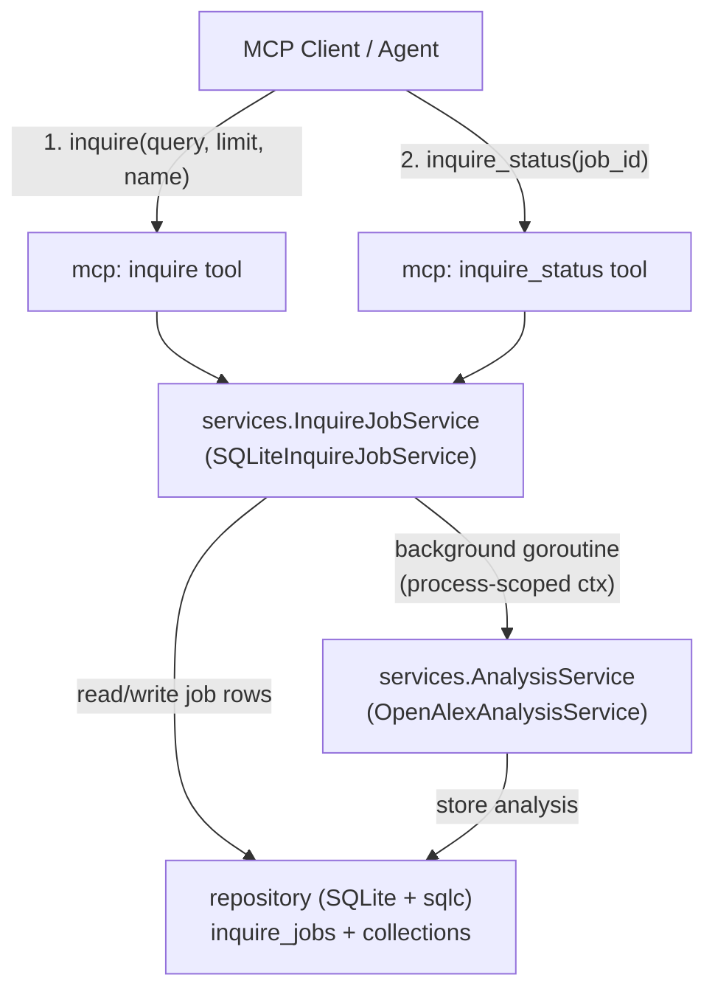

# Implementation Plan: Database-Backed Async `inquire` Jobs

## Problem Statement

`AnalysisService.Inquire` fetches seed works from OpenAlex, enriches their
references, runs the SAP Tree of Science algorithm, and writes the citation
graph to SQLite. Depending on `limit` and OpenAlex response times, this can take
30–60+ seconds.

Currently, the MCP `inquire` tool (`mcp/internal/tools/collections/inquire.go`)
blocks synchronously for the entire pipeline. Many MCP clients enforce a hard
per-tool-call timeout and abort the call before `inquire` finishes.

## Goals & Non-Goals

### Goals

- Allow the MCP `inquire` tool to start a background job and return well before
  client timeouts, with a companion `inquire_status` tool to poll for
  completion.
- Persist job state in SQLite so it survives per-request `mcp.NewServer`
  instantiation ([ADR-003](../adrs/ADR-003-publishing-the-mcp-server.md)) and
  remains inspectable across requests.
- Keep execution behind a small `services` interface so `bibx mcp` and
  single-node HTTP servers use a built-in in-process goroutine runner, while
  distributed or serverless hosts can swap in an external queue/worker.
- Preserve the fast path: cached collections return immediately in a single
  `inquire` call, and fast inquiries can complete within a short bounded wait
  without extra polling turns.
- Keep `AnalysisService.Inquire` synchronous so the CLI (`bibx inquire`) and
  direct Go library callers remain unaffected.

### Non-Goals

- General-purpose multi-job queueing, delayed scheduling, or automatic retries
  across process restarts (re-running `inquire` already provides idempotent
  recovery).
- Adding CGO or third-party queue dependencies to `go.mod`.

---

## Architecture Overview



Key architectural properties:

1. **Tier 1 (`repository/`)** owns the `inquire_jobs` schema, migrations, and
   `sqlc` queries.
2. **Tier 2 (`services/`)** owns the `InquireJobService` interface, domain
   deduplication (`ComputeQueryHash`), stage tracking, and the default
   in-process goroutine runner.
3. **Tier 3 (`mcp/`)** exposes `inquire` and `inquire_status` over the
   `InquireJobService` interface without holding durable job state inside
   `*mcp.Server`.

---

## Phase 1: Database Schema & Repository Layer (`repository/`)

### 1.1 SQLite Concurrency Pragma

In `repository/sqlite.go`, update `OpenSQLite` to configure a busy timeout
alongside WAL mode and foreign keys:

```sql
PRAGMA journal_mode=WAL;
PRAGMA foreign_keys=ON;
PRAGMA busy_timeout=5000;
```

This prevents `SQLITE_BUSY` errors when a background job updates its stage or
commits `StoreAnalysis` concurrently with `inquire_status` reads.

### 1.2 Migration `000006_add_inquire_jobs`

Create `repository/migrations/000006_add_inquire_jobs.up.sql` and
`000006_add_inquire_jobs.down.sql`:

```sql
CREATE TABLE inquire_jobs (
    id            BLOB(16) PRIMARY KEY,
    query_hash    BLOB(32) NOT NULL,
    query         TEXT NOT NULL,
    result_limit  INTEGER NOT NULL,
    name          TEXT,
    force         BOOLEAN NOT NULL DEFAULT 0,
    status        TEXT NOT NULL,
    stage         TEXT NOT NULL DEFAULT '',
    collection_id BLOB(16),
    is_new        BOOLEAN NOT NULL DEFAULT 0,
    seed_count    INTEGER NOT NULL DEFAULT 0,
    error         TEXT,
    created_at    DATETIME DEFAULT CURRENT_TIMESTAMP,
    updated_at    DATETIME DEFAULT CURRENT_TIMESTAMP,
    FOREIGN KEY (collection_id) REFERENCES collections(id) ON DELETE SET NULL
);

-- At most one active (pending or running) job per query_hash.
CREATE UNIQUE INDEX idx_inquire_jobs_active_hash
    ON inquire_jobs(query_hash)
    WHERE status IN ('pending', 'running');

CREATE INDEX idx_inquire_jobs_status_updated
    ON inquire_jobs(status, updated_at);
```

Down migration:

```sql
DROP TABLE IF EXISTS inquire_jobs;
```

Note: `sqlc.yaml` already maps `BLOB(16)` to `uuid.UUID` and nullable `BLOB(16)`
to `*uuid.UUID`, so `id` and `collection_id` work without extra type overrides.

### 1.3 `sqlc` Queries (`queries.sql`)

Add the following queries to `queries.sql` and run `sqlc generate`:

- `CreateInquireJob :exec` — inserts a new `pending` job row.
- `GetInquireJobByID :one` — fetches a job row by `id`.
- `GetActiveInquireJobByHash :one` — fetches the active (`pending` or `running`)
  job row for a `query_hash`.
- `UpdateInquireJobStage :exec` — updates `status`, `stage`, and `updated_at`
  for a job `id`.
- `CompleteInquireJob :exec` — sets `status = 'completed'`, `stage = 'done'`,
  `collection_id`, `is_new`, `seed_count`, and `updated_at`.
- `FailInquireJob :exec` — sets `status = 'failed'`, `error`, and `updated_at`.
- `FailStaleInquireJobs :exec` — marks any `pending`/`running` rows with
  `updated_at < ?` as `failed` with a recovery error message.
- `DeleteCompletedInquireJobsBefore :exec` — optional cleanup of terminal jobs
  older than a retention cutoff.

---

## Phase 2: Domain Services & In-Process Runner (`services/`)

### 2.1 Stage Progress Hook in `services/analysis.go`

Add stage constants and an optional callback to `InquireOptions` (backwards
compatible with all existing callers):

```go
type InquireStage string

const (
    StageQueued        InquireStage = "queued"
    StageFetchingSeeds InquireStage = "fetching_seeds"
    StageEnriching     InquireStage = "enriching"
    StageScoring       InquireStage = "scoring"
    StageStoring       InquireStage = "storing"
    StageDone          InquireStage = "done"
)

type InquireOptions struct {
    Force   bool
    Name    string
    OnStage func(stage InquireStage)
}
```

Invoke `opts.OnStage` (when non-nil) at the existing checkpoints inside
`OpenAlexAnalysisService.Inquire`:

1. `StageFetchingSeeds` before `s.openalexClient.SearchWorks`
2. `StageEnriching` before `s.enrich`
3. `StageScoring` before `algorithms.NewSapAlgorithm` / `sap.Run`
4. `StageStoring` before `s.StoreAnalysis`

Also expose a small helper (or check inside `InquireJobService`) for pre-flight
name validation and cache lookup so invalid requests fail synchronously before a
job is enqueued.

### 2.2 `InquireJob` Types & `InquireJobService` Interface (`services/inquire_job.go`)

Define the domain types and swappable service interface:

```go
type JobStatus string

const (
    JobStatusPending   JobStatus = "pending"
    JobStatusRunning   JobStatus = "running"
    JobStatusCompleted JobStatus = "completed"
    JobStatusFailed    JobStatus = "failed"
)

type InquireJob struct {
    ID           uuid.UUID
    Query        string
    ResultLimit  int
    Name         *string
    Status       JobStatus
    Stage        InquireStage
    CollectionID *uuid.UUID
    Collection   *Collection // populated when Status == JobStatusCompleted
    IsNew        bool
    SeedCount    int
    Error        string
    CreatedAt    time.Time
    UpdatedAt    time.Time
}

var ErrJobNotFound = errors.New("inquire job not found")

type InquireJobService interface {
    Start(ctx context.Context, query string, limit int, opts InquireOptions) (*InquireJob, error)
    Get(ctx context.Context, id uuid.UUID) (*InquireJob, error)
    Wait(ctx context.Context, id uuid.UUID, timeout time.Duration) (*InquireJob, error)
}
```

Keeping `InquireJobService` separate from `AnalysisService`:

- Avoids breaking existing `AnalysisService` implementations and mocks.
- Allows distributed/serverless hosts to provide a queue-backed
  `InquireJobService` while reusing `OpenAlexAnalysisService` inside their
  worker processes.

### 2.3 Default Implementation: `SQLiteInquireJobService`

Implement `SQLiteInquireJobService` in `services/inquire_job.go`:

```go
type InquireJobOption func(*SQLiteInquireJobService)

// WithJobContext sets the parent lifecycle context for background jobs.
// Defaults to context.Background().
func WithJobContext(ctx context.Context) InquireJobOption

// WithMaxConcurrentJobs sets the maximum number of concurrent inquire jobs.
// Defaults to 2.
func WithMaxConcurrentJobs(n int) InquireJobOption

// WithPollInterval sets the SQLite fallback poll interval used by Wait when
// the job is not being executed by this process instance. Defaults to 500ms.
func WithPollInterval(d time.Duration) InquireJobOption

func NewInquireJobService(
    db *sql.DB,
    analysisService AnalysisService,
    opts ...InquireJobOption,
) *SQLiteInquireJobService
```

#### Lifecycle & Concurrency

- Holds a runner-scoped `baseCtx, cancel := context.WithCancel(parentCtx)`, a
  buffered channel semaphore `sem := make(chan struct{}, maxConcurrent)`, a
  `sync.WaitGroup` tracking active goroutines, and a mutex-guarded
  `waiters map[uuid.UUID]chan struct{}`.
- `Close()` cancels `baseCtx` and waits for `wg.Wait()` so all background
  goroutines exit cleanly before `db.Close()` is called.
- `RecoverStale(ctx context.Context, maxAge time.Duration) error` marks orphaned
  `pending`/`running` jobs from a previous crashed process as `failed`. Call
  this on server startup (e.g., `maxAge = 0` on single-instance `bibx mcp`
  startup to fail any leftover active rows immediately, or e.g.
  `15 * time.Minute` in multi-instance setups).

#### `Start(ctx, query, limit, opts)` Flow

1. Normalize `query` and compute `queryHash := ComputeQueryHash(query, limit)`.
2. **Cache-hit fast path**: if `!opts.Force`, check `GetCollectionByHash`. If a
   current collection exists, return a completed `InquireJob` immediately
   (`Status: JobStatusCompleted`, `Stage: StageDone`, `Collection: existing`,
   `IsNew: false`) without spawning a goroutine or writing a job row.
3. **Pre-flight name check**: if `opts.Name != ""`, verify the name is not
   already held by a different collection (reusing `checkNameAvailable` logic)
   so conflicts return `ErrCollectionExists` synchronously.
4. **In-flight deduplication**: check `GetActiveInquireJobByHash`. If an active
   job already exists, return it instead of starting a duplicate fetch.
5. **Insert & dispatch**:
   - Create a UUIDv7 `jobID`, insert a `pending` row (`stage = "queued"`). If
     the partial unique index triggers a `UNIQUE constraint failed` race, fall
     back to `GetActiveInquireJobByHash` and return the winning job.
   - Register a completion channel in `waiters[jobID]`.
   - Increment `wg.Add(1)` and spawn `go s.runJob(jobID, query, limit, opts)`
     using `s.baseCtx` (**never** the request `ctx`).
   - Return the `pending` `InquireJob`.

#### `runJob` Execution

1. `defer s.wg.Done()` and `defer s.notifyDone(jobID)` (removes & closes
   `waiters[jobID]`).
2. Acquire semaphore slot (`select` on `s.sem <- struct{}{}` vs
   `<-s.baseCtx.Done()`); `defer func() { <-s.sem }()`.
3. Mark row `running` / `fetching_seeds`.
4. Call `s.analysisService.Inquire(s.baseCtx, query, limit, opts)` with
   `OnStage` calling `UpdateInquireJobStage` (best-effort; log warning on
   transient update error without aborting the inquiry).
5. On error: call `FailInquireJob` (using `context.WithoutCancel(s.baseCtx)`
   with a short 5s timeout so shutdown cancellations are still recorded).
6. On success: call `CompleteInquireJob` with `res.Collection.ID`, `res.IsNew`,
   and `res.SeedCount`.

#### `Get(ctx, id)` & `Wait(ctx, id, timeout)`

- `Get`: reads `GetInquireJobByID`. If `status == "completed"` and
  `collection_id != nil`, loads the collection via `GetCollectionByID` and
  attaches it to `job.Collection`.
- `Wait`:
  1. Calls `Get(ctx, id)`. If already terminal (`completed` or `failed`) or
     `timeout <= 0`, returns immediately.
  2. If `jobID` has a local channel in `waiters`, blocks on `select` over
     `<-ch`, `<-time.After(timeout)`, and `<-ctx.Done()`, then returns
     `Get(ctx, id)`.
  3. If `jobID` is not in `waiters` (e.g., running in another process or
     worker), polls `Get(ctx, id)` on a ticker (`pollInterval`, default 500ms)
     until terminal, `timeout`, or `ctx.Done()`.

---

## Phase 3: MCP Server & Tools (`mcp/`)

### 3.1 Server Configuration (`mcp/server.go`)

Make `services.InquireJobService` a required parameter of `mcp.NewServer`
(superseding the two-service signature in
[ADR-003](../adrs/ADR-003-publishing-the-mcp-server.md)) and add an option to
tune the default bounded wait:

```go
func NewServer(
    collectionService services.CollectionService,
    analysisService services.AnalysisService,
    inquireJobService services.InquireJobService,
    opts ...Option,
) *sdk.Server

// WithInquireWaitTimeout sets how long inquire waits for a newly started job
// to finish before returning status "running". Defaults to 10s (well under the
// lowest ~20s MCP client timeouts).
func WithInquireWaitTimeout(d time.Duration) Option
```

- `inquire` always uses `inquireJobService`, and `inquire_status` is always
  registered.

### 3.2 Updated `inquire` Tool (`mcp/internal/tools/collections/inquire.go`)

Add `ReturnImmediately` to `InquireInput` so clients with tight timeouts (or
clients that prefer explicit polling) can bypass the initial short wait:

```go
type InquireInput struct {
    Query             string `json:"query" jsonschema:"A single research concept of 1-3 words, e.g. 'stream processing'. Every term must appear in a work's title or abstract, so long multi-concept queries return almost nothing; inquire separate concepts into separate collections instead."`
    Limit             int    `json:"limit,omitempty" jsonschema:"Maximum number of initial seed works to fetch from OpenAlex (1-1000, default: 200). For best results, try between 200 and 500."`
    Force             bool   `json:"force,omitempty" jsonschema:"Re-fetch from OpenAlex and recompute the citation graph even if a cached collection exists for this query and limit"`
    Name              string `json:"name,omitempty" jsonschema:"Optional human-readable alias for referencing this collection in other tools"`
    ReturnImmediately bool   `json:"return_immediately,omitempty" jsonschema:"Return immediately with a job_id on a cache miss instead of waiting briefly for completion"`
}
```

Update `InquireOutput`:

```go
type InquireOutput struct {
    Status     string                    `json:"status" jsonschema:"Job status: pending, running, completed, or failed"`
    JobID      string                    `json:"job_id,omitempty" jsonschema:"Job UUID to pass to inquire_status when status is pending or running"`
    Stage      string                    `json:"stage,omitempty" jsonschema:"Current execution stage when the job is still in progress"`
    Collection *models.CollectionSummary `json:"collection,omitempty" jsonschema:"Metadata of the created or cached bibliographic collection (present when status is completed)"`
    IsNew      bool                      `json:"is_new,omitempty" jsonschema:"True if newly fetched and analyzed; false if an existing cached collection was returned"`
    Warnings   []string                  `json:"warnings,omitempty" jsonschema:"Problems with the result that may need a different query, such as far fewer matching works than requested"`
    Error      string                    `json:"error,omitempty" jsonschema:"Error message if the inquiry job failed"`
}
```

Behavior in `Inquire.Handle`:

1. Validate `query` and `limit` as before.
2. Call `job, err := i.jobs.Start(ctx, query, limit, ...)`.
3. If `job.Status` is `pending` or `running` **and** `!input.ReturnImmediately`,
   call `job, err = i.jobs.Wait(ctx, job.ID, i.waitTimeout)` (default `10s`).
   When `input.ReturnImmediately` is `true`, skip `Wait` and return the started
   job immediately (cache hits still return `status: "completed"` right away).
4. Map `job` to `InquireOutput` (computing `inquireWarnings` when
   `job.Status == JobStatusCompleted`).
5. If `job.Status == JobStatusFailed`, return a tool error (`IsError: true`)
   with `job.Error`.

### 3.3 New `inquire_status` Tool (`mcp/internal/tools/collections/inquire_status.go`)

```go
type InquireStatusInput struct {
    JobID       string `json:"job_id" jsonschema:"Job UUID returned by inquire"`
    WaitSeconds int    `json:"wait_seconds,omitempty" jsonschema:"Optional seconds to wait for completion before returning (0-15, default: 10; pass 0 to check immediately)"`
}
```

- Output reuses `InquireOutput` so agents see a consistent shape across
  `inquire` and `inquire_status`.
- Tool annotations: `ReadOnlyHint: true`, `IdempotentHint: true`,
  `DestructiveHint: false`, `OpenWorldHint: false`.
- Parses `job_id` as `uuid.UUID`, validates `wait_seconds` (`0 <= w <= 15`,
  default `10` so every call stays safely under ~20s client timeouts), calls
  `jobSvc.Wait(ctx, id, wait)` (or `Get` when `0`), and returns the mapped
  `InquireOutput`.
- Always registered in `mcp/internal/tools/register.go`.

### 3.4 Agent Instructions & Prompts

- Update `mcp/instructions.txt` workflow step 1: explain that `inquire` may
  return `status: "running"` with a `job_id` and `stage`, and instruct the agent
  to call `inquire_status(job_id=...)` until `status` is `"completed"` (or
  `"failed"`).
- Update `mcp/internal/prompts/review.md` and `mcp/internal/prompts/gaps.md`
  Phase 1 with a brief note to poll `inquire_status` if `inquire` returns a
  running job.

---

## Phase 4: CLI MCP Command Wiring (`internal/cli/commands/mcp/mcp.go`)

Update `bibx mcp` startup and shutdown order:

```go
colSvc := services.NewCollectionService(db)
anaSvc := services.NewAnalysisService(db, openalex.NewRestyClient())
jobSvc := services.NewInquireJobService(db, anaSvc, services.WithJobContext(ctx))
defer jobSvc.Close()

if err := jobSvc.RecoverStale(ctx, 0); err != nil {
    return fmt.Errorf("failed to recover stale inquire jobs: %w", err)
}

server := bibxmcp.NewServer(colSvc, anaSvc, jobSvc)
```

Note the `defer` order: `defer jobSvc.Close()` is registered _after_
`defer db.Close()`, so LIFO execution ensures all background goroutines stop
before the SQLite connection is closed.

---

## Phase 5: Mocks, Testing & Verification

### 5.1 Regenerate Code & Mocks

1. `sqlc generate` and verify `sqlc diff` is clean.
2. `mockery` to generate `internal/mocks/services/inquire_job_service.go`.

### 5.2 Test Matrix

| Package                           | Test Cases                                                                                                                                                                                                                                                                                                                                           |
| --------------------------------- | ---------------------------------------------------------------------------------------------------------------------------------------------------------------------------------------------------------------------------------------------------------------------------------------------------------------------------------------------------- |
| `repository/sqlite_test.go`       | Migration 000006 up/down; `busy_timeout` pragma set; partial unique index blocks two active jobs for the same `query_hash` while allowing historical completed/failed rows; stale fail.                                                                                                                                                              |
| `services/inquire_job_test.go`    | Cache-hit fast path; async `Start` → stage transitions → `Complete`; concurrent `Start` deduplication; pre-flight name conflict; `Inquire` error recorded as `failed`; `Wait` wake-up and timeout; `Wait` cross-process DB polling fallback; `Close()` cancels in-flight job cleanly; `RecoverStale` marks orphaned jobs failed.                     |
| `mcp/internal/tools/collections/` | `inquire` returns completed immediately on cache hit; `inquire` returns `running` + `job_id` on timeout; `inquire` with `return_immediately: true` skips `Wait`; `inquire_status` polls to completion and surfaces warnings; invalid UUID, out-of-range `wait_seconds`, and unknown job errors; `mcptest.AssertPropertyDescriptions` for both tools. |
| `mcp/server_test.go`              | `ListTools` includes `inquire_status` alongside the existing 8 tools (9 total).                                                                                                                                                                                                                                                                      |

### 5.3 Verification Commands

```bash
sqlc diff
go test -race ./...
golangci-lint run
```

---

## Rollout Order

1. **PR 1 — Tier 1 & Tier 2**: Migration `000006`, `busy_timeout`, `sqlc`
   queries, `InquireOptions.OnStage`, `services.InquireJobService`,
   `SQLiteInquireJobService`, and unit tests.
2. **PR 2 — Tier 3 & Docs**: Required `InquireJobService` param on
   `mcp.NewServer`, updated `inquire` (with `return_immediately`), new
   `inquire_status`, `instructions.txt`/prompt updates, `bibx mcp` wiring, and
   an ADR documenting the async job contract.
