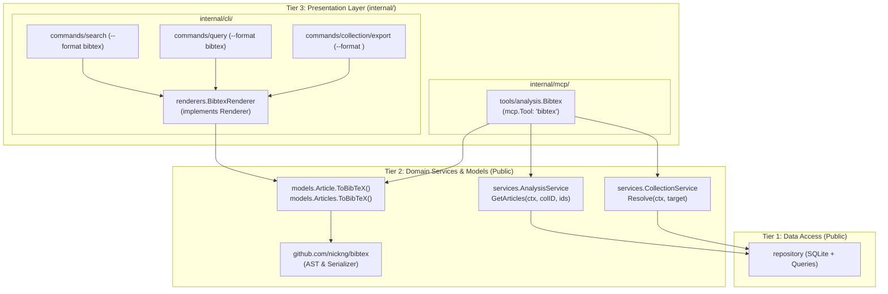
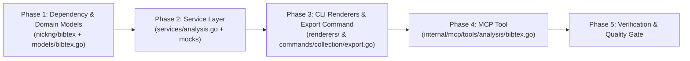

# Implementation Plan: BibTeX Output Support for CLI and MCP

## 1. Overview & Goals

The `bibx` tool provides bibliographic inquiry, network analysis (Tree of Science / SAP, Leiden community detection), and semantic search for academic literature. While `bibx` currently supports output formats such as `json`, `simple`, `markdown`, and `reference`, exporting citations in **BibTeX** format is critical for integration with LaTeX workflows, reference managers (Zotero, JabRef), and downstream agentic research tools.

This plan details the implementation of BibTeX output capabilities across both presentation interfaces:
1. **CLI**:
   - Add `"bibtex"` as a first-class format option (`--format bibtex` / `-f bibtex`) to `bibx search` and `bibx query`.
   - Add a new `bibx collection export` subcommand (`bibx collection export [<target>] --format <format> [--output <file>]`) to dump an entire collection in BibTeX or any other supported format.
2. **MCP (Model Context Protocol)**:
   - Add a dedicated `bibtex` tool that allows AI agents to export selected articles (by article ID, DOI, or label) or an entire collection in BibTeX format (when `ids` is omitted or empty).
3. **Serialization Engine**:
   - Use `github.com/nickng/bibtex` for AST-backed, battle-tested BibTeX serialization with deterministic field ordering via `WithKeyOrder`.

---

## 2. Architecture & Alignment with ADR-001

Per [ADR-001](file:///home/oscar/Code/coreofscience/go-bibx/docs/adrs/ADR-001-adopting-three-tier-architecture.md), `go-bibx` follows a strict Three-Tier Architecture. Internal presentation packages (`internal/cli` and `internal/mcp`) must never depend on each other.

To prevent cross-presentation dependencies while maximizing code reuse, core BibTeX formatting logic will reside in **Tier 2 (Domain Models)**:



---

## 3. Serialization Engine: `github.com/nickng/bibtex`

### 3.1. Rationale & Evaluation

Introducing `github.com/nickng/bibtex` provides significant advantages over manual string formatting:
- **Battle-tested Syntax**: Correctly handles BibTeX delimiters, braces, commas, escaping, and formatting standards recognized by TeXLive, Biber, Zotero, and JabRef.
- **Zero Transitive Dependencies**: `github.com/nickng/bibtex` depends exclusively on the Go standard library, keeping `go.mod` clean and avoiding dependency bloat.
- **Deterministic Field Ordering**: Version 1.2+ supports `bibtex.WithKeyOrder([]string{...})`, ensuring fields appear consistently across runs (`author`, `title`, `journal`, `year`, `volume`, `number`, `pages`, `doi`, `url`, etc.).
- **Bidirectional Extensibility**: Using an established AST (`BibTex`, `BibEntry`, `BibConst`) provides an immediate path to supporting BibTeX *importing* (`bibx import --format bibtex`) in future iterations.

### 3.2. Mapping & Serialization Pattern

```go
package models

import (
    "github.com/nickng/bibtex"
)

var defaultBibtexKeyOrder = []string{
    "author",
    "title",
    "journal",
    "year",
    "volume",
    "number",
    "pages",
    "doi",
    "url",
    "keywords",
    "abstract",
}

func (a *Article) ToBibEntry(citeKey ...string) *bibtex.BibEntry {
    entryType := "misc"
    if a.Journal != nil && *a.Journal != "" {
        entryType = "article"
    }

    key := GenerateCitationKey(a)
    if len(citeKey) > 0 && citeKey[0] != "" {
        key = citeKey[0]
    }

    entry := bibtex.NewBibEntry(entryType, key)

    if len(a.Authors) > 0 {
        entry.AddField("author", bibtex.NewBibConst(strings.Join(a.Authors, " and ")))
    }
    if a.Title != nil && *a.Title != "" {
        entry.AddField("title", bibtex.NewBibConst(*a.Title))
    }
    if a.Journal != nil && *a.Journal != "" {
        entry.AddField("journal", bibtex.NewBibConst(*a.Journal))
    }
    if a.Year != nil {
        entry.AddField("year", bibtex.NewBibConst(fmt.Sprintf("%d", *a.Year)))
    }
    if a.Volume != nil && *a.Volume != "" {
        entry.AddField("volume", bibtex.NewBibConst(*a.Volume))
    }
    if a.Issue != nil && *a.Issue != "" {
        entry.AddField("number", bibtex.NewBibConst(*a.Issue))
    }
    if a.Page != nil && *a.Page != "" {
        // Normalize page range (e.g., "12-34" -> "12--34")
        pages := strings.ReplaceAll(*a.Page, "-", "--")
        pages = strings.ReplaceAll(pages, "----", "--")
        entry.AddField("pages", bibtex.NewBibConst(pages))
    }
    if a.DOI != nil && *a.DOI != "" {
        entry.AddField("doi", bibtex.NewBibConst(utils.ExtractDOI(*a.DOI)))
    }
    if link := a.GetPermalink(); link != nil && *link != "" {
        entry.AddField("url", bibtex.NewBibConst(*link))
    }
    if a.Keywords != nil && a.Keywords.Len() > 0 {
        entry.AddField("keywords", bibtex.NewBibConst(strings.Join(a.Keywords.Items(), ", ")))
    }
    if a.Abstract != nil && *a.Abstract != "" {
        cleanAbstract := strings.Join(strings.Fields(*a.Abstract), " ")
        entry.AddField("abstract", bibtex.NewBibConst(cleanAbstract))
    }

    return entry
}

func (a *Article) ToBibTeX(citeKey ...string) string {
    entry := a.ToBibEntry(citeKey...)
    return entry.PrettyString(bibtex.WithKeyOrder(defaultBibtexKeyOrder))
}
```

---

## 4. Detailed Technical Design

### 4.1. Domain Models: BibTeX Formatting (`models/bibtex.go`)

#### 4.1.1. Citation Key Generation & Disambiguation

1. **Key Generation Strategy**:
   - Primary: Use `art.SimpleId()` (e.g., `vaswani2017`).
   - Fallback 1: If DOI exists, use sanitized DOI slug (e.g., `doi_10_1145_3295222`).
   - Fallback 2: If OpenAlex ID exists, use sanitized ID (e.g., `w2741809807`).
   - Fallback 3: Sanitized article `Label` or `Key()`.
   - Sanitization: Replace non-alphanumeric characters with underscores, collapse consecutive underscores, and convert to lowercase.

2. **Collision Disambiguation**:
   - `models.Articles.ToBibTeX()` tracks seen keys across the export set using a frequency map.
   - If `vaswani2017` is encountered multiple times, subsequent occurrences receive alphabetical suffixes (`vaswani2017a`, `vaswani2017b`, etc.).

#### 4.1.2. Method Signatures

```go
package models

// ToBibEntry converts the Article into a *bibtex.BibEntry.
func (a *Article) ToBibEntry(citeKey ...string) *bibtex.BibEntry

// ToBibTeX formats a single Article into a BibTeX entry string.
func (a *Article) ToBibTeX(citeKey ...string) string

// ToBibTeX formats a collection of Articles into a concatenated BibTeX string,
// automatically disambiguating duplicate citation keys.
func (a Articles) ToBibTeX() string

// GenerateCitationKey generates a clean, URL-safe citation key for an article.
func GenerateCitationKey(a *Article) string
```

---

### 4.2. Domain Service: Article Lookup (`services/analysis.go`)

To allow presentation layers to retrieve specific articles from a collection by ID, `services.AnalysisService` will be extended.

#### 4.2.1. Interface Update

```go
type AnalysisService interface {
    // Existing methods
    Inquire(ctx context.Context, query string, limit int, opts InquireOptions) (*InquireResult, error)
    StoreAnalysis(ctx context.Context, collectionID uuid.UUID, a *models.Analysis) error
    LoadAnalysis(ctx context.Context, collectionID uuid.UUID) (*models.Analysis, error)
    QueryCategory(ctx context.Context, collectionID uuid.UUID, category string, limit int) ([]*models.Result, error)
    Search(ctx context.Context, collectionID uuid.UUID, query string, limit int) (*models.Analysis, error)

    // New method for article retrieval
    GetArticles(ctx context.Context, collectionID uuid.UUID, ids []string) ([]*models.Article, []string, error)
}
```

#### 4.2.2. Lookup & ID Matching Logic

The matching logic resolves against:
1. `node.ID` (direct match).
2. `art.Label` (direct match).
3. `art.SimpleId()` (e.g., `vaswani2017`).
4. `art.DOI` (with or without `doi:`, `https://doi.org/`, `http://dx.doi.org/`).
5. `art.IDs` set items (with or without prefix, e.g., `openalex:https://openalex.org/W...` or `https://openalex.org/W...`).

Returns:
- `[]*models.Article`: Found articles (ordered matching input `ids`).
- `[]string`: Slice of requested IDs that could not be matched (`not_found`).
- `error`: Database or collection resolution errors.

*Note: If `ids` is empty or nil, `GetArticles` returns all articles belonging to the collection.*

---

### 4.3. CLI Presentation: Renderer & Commands

#### 4.3.1. BibTeX Renderer (`internal/cli/renderers/bibtex.go`)

Create `BibtexRenderer` implementing `renderers.Renderer`:

```go
package renderers

import (
    "io"
    "github.com/coreofscience/go-bibx/models"
)

type BibtexRenderer struct{}

func NewBibtexRenderer() *BibtexRenderer {
    return &BibtexRenderer{}
}

func (r *BibtexRenderer) RenderResults(w io.Writer, results []*models.Result) error {
    articles := make(models.Articles, 0, len(results))
    for _, res := range results {
        if res != nil && res.Article != nil {
            articles = append(articles, res.Article)
        }
    }
    _, err := io.WriteString(w, articles.ToBibTeX())
    return err
}

func (r *BibtexRenderer) RenderAnalysis(w io.Writer, analysis *models.Analysis) error {
    if analysis == nil {
        return nil
    }
    articles := make(models.Articles, 0, len(analysis.Nodes))
    for _, node := range analysis.Nodes {
        if node != nil && node.Article != nil {
            articles = append(articles, node.Article)
        }
    }
    _, err := io.WriteString(w, articles.ToBibTeX())
    return err
}
```

#### 4.3.2. Format Registration (`internal/cli/renderers/renderer.go`)

Add `"bibtex"` to `AnalysisFormats()` and `ResultFormats()`, and register `NewBibtexRenderer()` in `NewRendererWithFormat()`.

Because `search.go` and `query.go` derive their supported formats and validation directly from `renderers.AnalysisFormats()` and `renderers.ResultFormats()`, both CLI commands automatically gain `--format bibtex` support:
```bash
# Export search results as BibTeX
bibx search "quantum computing" --format bibtex

# Export top root articles as BibTeX
bibx query --category root --limit 10 --format bibtex
```

#### 4.3.3. New Subcommand: `bibx collection export` (`internal/cli/commands/collection/export.go`)

Add `export` subcommand under `collection` (`internal/cli/commands/collection/export.go`):

```bash
# Export latest collection as BibTeX to stdout
bibx collection export

# Export a specific collection by name alias or UUID as BibTeX to a file
bibx collection export my-graph --format bibtex --output references.bib

# Export entire collection as JSON or markdown
bibx collection export --format json
```

**Implementation Details**:
- **Arguments**: `[<target>]` (collection ID or name alias, defaults to latest).
- **Flags**:
  - `--format` / `-f`: string flag, default `"bibtex"`, validated against `renderers.AnalysisFormats()`.
  - `--output` / `-o`: string flag, optional file destination (defaults to `os.Stdout`).
- **Action**:
  1. Resolves collection via `colSvc.Resolve(ctx, target)`.
  2. Loads full analysis via `anaSvc.LoadAnalysis(ctx, col.ID)`.
  3. Renders via `renderers.NewAnalysisRendererWithFormat(format).RenderAnalysis(writer, analysis)`.
  4. Flushes and closes file if `--output` was specified.
- Register `newExportCommand()` in `internal/cli/commands/collection/collection.go`.

---

### 4.4. MCP Presentation: `bibtex` Tool (`internal/mcp/tools/analysis/bibtex.go`)

#### 4.4.1. Tool Specification

- **Tool Name**: `bibtex`
- **Title**: `Export BibTeX`
- **Description**: `output selected articles from a collection in BibTeX format by their article IDs (or all articles if IDs are omitted)`
- **Annotations**: Read-only, idempotent hint `true`, destructive hint `false`.

#### 4.4.2. Input & Output Schemas

```go
type BibtexInput struct {
    // IDs is the list of article IDs, DOIs, or labels to export. If omitted, exports all articles in the collection.
    IDs []string `json:"ids,omitempty"`
    // Target is the collection ID (UUID) or name alias. If omitted, the latest collection is queried.
    Target string `json:"target,omitempty"`
}

type BibtexOutput struct {
    // Bibtex contains the formatted BibTeX entries string.
    Bibtex string `json:"bibtex"`
    // Count is the number of articles successfully exported.
    Count int `json:"count"`
    // NotFound contains any input IDs that could not be resolved.
    NotFound []string `json:"not_found,omitempty"`
}
```

#### 4.4.3. Execution Behavior

1. Resolves target collection using `collectionService.Resolve(ctx, input.Target)`.
2. Calls `analysisService.GetArticles(ctx, col.ID, input.IDs)`.
   - If `input.IDs` is non-empty: returns matching articles and any unresolved IDs in `NotFound`.
   - If `input.IDs` is omitted/empty: exports all articles in the collection (`NotFound` is empty).
3. Formats articles to BibTeX via `models.Articles(articles).ToBibTeX()`.
4. Returns `CallToolResult` with `BibtexOutput`.

#### 4.4.4. Tool Registration (`internal/mcp/tools/register.go`)

Register `analysis.NewBibtex(analysisService, collectionService).Register(server)` in `internal/mcp/tools/register.go`.

---

## 5. Implementation Steps & Roadmap



### Phase 1: Dependency & Domain Models
1. Add `github.com/nickng/bibtex` to `go.mod` via `go get github.com/nickng/bibtex`.
2. Implement `models/bibtex.go`:
   - `GenerateCitationKey(a *Article) string` with sanitization.
   - `(*Article).ToBibEntry(...) *bibtex.BibEntry` mapping metadata fields.
   - `(*Article).ToBibTeX(...) string` utilizing `PrettyString` with `WithKeyOrder`.
   - `(Articles).ToBibTeX() string` with duplicate key collision disambiguation.
3. Add unit tests in `models/bibtex_test.go`:
   - Comprehensive article with all fields.
   - Minimal article without journal (`@misc`).
   - Duplicate citation key collision disambiguation (`smith2020`, `smith2020a`).
   - Multiline abstracts and whitespace normalization.

### Phase 2: Domain Services & Mocks
1. Add `GetArticles(ctx context.Context, collectionID uuid.UUID, ids []string) ([]*models.Article, []string, error)` to `services.AnalysisService`.
2. Implement article ID matching logic in `OpenAlexAnalysisService`.
3. Add unit tests in `services/analysis_test.go`.
4. Update/regenerate test mocks using `mockery`.

### Phase 3: CLI Presentation Layer
1. Implement `internal/cli/renderers/bibtex.go` (`BibtexRenderer`).
2. Add `"bibtex"` to `renderers.AnalysisFormats()`, `renderers.ResultFormats()`, and `NewRendererWithFormat`.
3. Add unit tests in `internal/cli/renderers/bibtex_test.go`.
4. Implement `newExportCommand()` in `internal/cli/commands/collection/export.go` supporting `--format` and `--output`.
5. Register `export` subcommand in `internal/cli/commands/collection/collection.go`.
6. Add unit tests in `internal/cli/commands/collection/collection_test.go` or `export_test.go`.

### Phase 4: MCP Tool Implementation
1. Create `internal/mcp/tools/analysis/bibtex.go` (`Bibtex` tool).
2. Wire collection target resolution and article lookup.
3. Register tool in `internal/mcp/tools/register.go`.
4. Add unit tests in `internal/mcp/tools/analysis/bibtex_test.go` using `mcptest.Connect`:
   - Selected IDs export.
   - Full collection export when `ids` is omitted.
   - Reporting unresolved IDs in `NotFound`.
   - Target collection resolution by ID and alias.
   - Error handling for non-existent collections.

### Phase 5: Verification & Documentation
1. Run full test suite: `go test -v ./...`.
2. Run linter: `golangci-lint run`.
3. Verify CLI execution manually:
   - `bibx query --category root --format bibtex`
   - `bibx search <query> --format bibtex`
   - `bibx collection export --format bibtex`
4. Verify MCP protocol tool listing and execution.

---

## 6. Testing & Verification Matrix

| Component | Test Scenarios | Verification Method |
| :--- | :--- | :--- |
| **`models.Article.ToBibTeX()`** | <ul><li>Article with full metadata (`@article`)</li><li>Article without journal (`@misc`)</li><li>Missing year / author fallback key</li><li>Escaped braces and normalized whitespace in abstracts</li><li>Deterministic key ordering</li></ul> | `go test -v ./models -run TestBibTeX` |
| **`models.Articles.ToBibTeX()`** | <ul><li>Duplicate citation keys disambiguated (`a`, `b`)</li><li>Preserves order of articles</li><li>Empty slice returns empty string</li></ul> | `go test -v ./models -run TestArticles_ToBibTeX` |
| **`AnalysisService.GetArticles`** | <ul><li>Match by node ID</li><li>Match by DOI (with and without prefix)</li><li>Match by OpenAlex ID</li><li>Partial match with `not_found` reporting</li><li>Empty `ids` returns all articles in collection</li></ul> | `go test -v ./services -run TestGetArticles` |
| **`renderers.BibtexRenderer`** | <ul><li>`RenderResults` outputs valid BibTeX stream</li><li>`RenderAnalysis` outputs valid BibTeX stream</li><li>`AnalysisFormats()` and `ResultFormats()` include `"bibtex"`</li></ul> | `go test -v ./internal/cli/renderers` |
| **`bibx collection export`** | <ul><li>Exports latest collection as BibTeX</li><li>Exports specified collection by alias</li><li>Exports to custom `--output` file</li><li>Supports all analysis formats (`json`, `markdown`, etc.)</li></ul> | `go test -v ./internal/cli/commands/collection` |
| **MCP `bibtex` Tool** | <ul><li>List tools shows `bibtex` with valid JSONSchema</li><li>Call tool with selected `ids` and `target`</li><li>Call tool with empty `ids` (exports all)</li><li>Call tool with unknown IDs (populates `not_found`)</li><li>Non-existent collection returns error</li></ul> | `go test -v ./internal/mcp/tools/analysis -run TestBibtexTool` |
