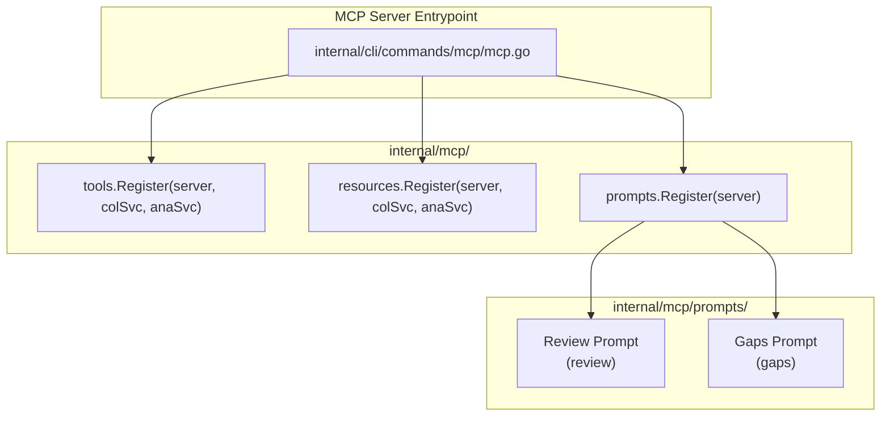

# Implementation Plan: MCP Prompts for Literature Review and Research Gaps

This plan outlines the design, architecture, and step-by-step implementation for adding Model Context Protocol (MCP) prompt templates to `go-bibx`. These prompts guide AI assistants and researchers in conducting systematic literature reviews and finding research gaps using the Tree of Science (ToS) methodology.

---

## 1. Context & Motivation

### Current State
In `go-bibx`, the MCP server (`internal/cli/commands/mcp/mcp.go`) advertises the `Prompts` capability:

```go
Capabilities: &mcp.ServerCapabilities{
    Prompts: &mcp.PromptCapabilities{
        ListChanged: false,
    },
    ...
}
```

However, the server currently only registers **tools** (`internal/mcp/tools`) and **resources** (`internal/mcp/resources`). No prompt templates are currently registered (`prompts/list` returns an empty array).

### Objectives
1. Introduce an `internal/mcp/prompts` package following the 3-Tier Architecture (ADR-001).
2. Implement the **`review`** prompt: Guides an LLM agent through conducting a rigorous, structured academic literature review on a given research topic using the Tree of Science methodology (`inquire`, `tos`, and `search`).
3. Implement the **`gaps`** prompt: Guides an LLM agent through analyzing citation network topology to discover unaddressed research gaps, isolated frontier topics, disconnected foundational lineages, and methodological lags.
4. Keep bibliographic export decoupled: `bibtex` tool usage is omitted from default prompt flows, remaining available on user demand when an export is explicitly requested.
5. Integrate prompt registration into the MCP server startup.
6. Provide comprehensive test coverage using in-memory MCP client/server test harnesses.

---

## 2. Architecture & Package Structure

Following the Three-Tier Architecture established in [ADR-001](file:///home/oscar/Code/coreofscience/go-bibx/docs/adrs/ADR-001-adopting-three-tier-architecture.md), prompts belong to **Tier 3 (Presentation & Delivery)**:

```
internal/mcp/
├── models/         # Schema-safe MCP DTOs
├── resources/      # MCP Resource definitions & registration
│   ├── collections/
│   ├── theory/
│   └── register.go
├── tools/          # MCP Tool definitions & registration
│   ├── analysis/
│   ├── collections/
│   └── register.go
├── prompts/        # [NEW] MCP Prompt definitions & registration
│   ├── review.go
│   ├── gaps.go
│   ├── register.go
│   └── prompts_test.go
└── test/           # Test helpers (Connect, AssertPropertyDescriptions)
```

### Component Roles



---

## 3. Detailed Prompt Specifications

### 3.1. Literature Review Prompt (`review`)

- **Name**: `review`
- **Title**: `Conduct a Literature Review with Tree of Science`
- **Description**: `Structured workflow to perform a systematic literature review on a topic using the Tree of Science (roots, trunks, leaves) methodology and bibx MCP tools.`
- **Arguments**:
  - `topic` (`string`, **Required**): The research topic, question, or keywords to review (e.g. `"graph neural networks for drug discovery"`).
  - `target` (`string`, Optional): Existing collection UUID or name alias. If omitted or not found, instructions direct the agent to fetch a new collection via `inquire`.
- **Role**: `mcp.RoleUser`
- **Prompt Content / Instructions**:
  Provides a structured 4-phase operational guide for the AI assistant:
  1. **Landscape Acquisition**:
     - Check if `target` exists via `show` or `list`.
     - If no collection exists, fetch literature from OpenAlex using `inquire(query="<topic>", limit=300-500)`.
     - Point to `bibx:/summary` resource for Tree of Science background.
  2. **Tree of Science Bibliometric Triangulation**:
     - **Roots** (`tos(category="root", limit=10)`): Identify foundational theories, seminal algorithms, and historical origin papers.
     - **Trunks** (`tos(category="trunk", limit=10)`): Identify structural developments, key methodologies, paradigm shifts, and connecting bridges.
     - **Leaves** (`tos(category="leaf", limit=20-30)`): Identify contemporary frontiers, current state-of-the-art developments, and recent experimental applications.
  3. **Thematic Deep-Dive via Graph Search**:
     - Identify recurring sub-themes or contentious issues in the leaves.
     - Execute Steiner tree search with `search(query="<subtheme>", limit=10-20)` to trace how specific subtopics connect back to foundational literature.
  4. **Synthesis & Report Structure**:
     - Structure the written review into standard scholarly sections:
       - **Introduction & Scope**: Core questions, bibliometric volume, and boundaries.
       - **Foundational Heritage (Roots)**: Seminal theoretical roots and underlying assumptions.
       - **Structural Evolution (Trunks)**: Methodological progressions, consolidation of schools of thought, and transition points.
       - **Current State-of-the-Art (Leaves)**: Modern advances, competing methodologies, and active research directions.
       - **Critical Discussion**: Methodological agreements, contradictions, and open questions.

---

### 3.2. Research Gaps Prompt (`gaps`)

- **Name**: `gaps`
- **Title**: `Find Research Gaps with Tree of Science`
- **Description**: `Systematic methodology to identify unexplored gaps, disconnected lineages, and frontier opportunities in a field using Tree of Science network analysis.`
- **Arguments**:
  - `topic` (`string`, **Required**): The research field or problem domain to inspect for literature gaps.
  - `target` (`string`, Optional): Existing collection UUID or name alias.
- **Role**: `mcp.RoleUser`
- **Prompt Content / Instructions**:
  Provides a network-heuristic framework for discovering research gaps:
  1. **Domain Ingestion & Baseline**:
     - Inquire the field (`inquire(query="<topic>", limit=300-500)`) to construct a dense citation graph.
     - Extract established knowledge baseline: `tos(category="root", limit=10)` (foundational premises) and `tos(category="trunk", limit=10)` (standard methodologies).
  2. **Frontier Mapping**:
     - Query modern leaves: `tos(category="leaf", limit=30-40)`.
     - Group leaves by application domain, technique, and which trunk methodologies they rely on.
  3. **Graph Topology Gap Detection Heuristics**:
     - **Heuristic 1: Disconnected Trunk Lines (Interdisciplinary / Bridge Gap)**:
       Two distinct trunk methodologies or root branches co-exist in the collection, but have very few citation paths connecting them. Opportunity: synthesize or transfer concepts between them.
     - **Heuristic 2: Isolated / Ungrounded Leaves (Theoretical Grounding Gap)**:
       Recent leaves addressing novel problems that lack strong citation links back to core trunks/roots. Opportunity: formalize the theoretical foundations of these empirical works.
     - **Heuristic 3: Methodological Lag (Technique Transfer Gap)**:
       Trunk methodologies that revolutionized adjacent problems but have not yet been applied to active leaf clusters.
     - **Heuristic 4: Contradictory Paradigms (Consensus / Verification Gap)**:
       Divergent trunk pathways offering incompatible explanations or conflicting empirical results without subsequent reconciliation.
     - **Heuristic 5: Subgraph Sparsity via Steiner Search**:
       Use `search(query="<concept_A>")` and `search(query="<concept_B>")` to reveal sparse connectivity, missing bridge papers, or bottlenecks in the citation subgraph.
  4. **Formulating Actionable Research Questions**:
     - Transform each detected gap into concrete, high-impact research questions with:
       - Problem statement & identified gap type.
       - Anchor citations (foundational roots and frontier leaves involved).
       - Proposed methodological bridge.

---

## 4. Implementation Details

### 4.1. File Layout & Signatures

#### `internal/mcp/prompts/review.go`
```go
package prompts

import (
    "context"
    "fmt"
    "strings"

    "github.com/modelcontextprotocol/go-sdk/mcp"
)

type Review struct{}

func NewReview() *Review {
    return &Review{}
}

func (p *Review) Prompt() *mcp.Prompt {
    return &mcp.Prompt{
        Name:        "review",
        Title:       "Conduct a Literature Review with Tree of Science",
        Description: "Structured workflow to perform a systematic literature review on a topic using the Tree of Science (roots, trunks, leaves) methodology and bibx MCP tools.",
        Arguments: []*mcp.PromptArgument{
            {
                Name:        "topic",
                Title:       "Research Topic",
                Description: "The research topic, question, or keywords to review",
                Required:    true,
            },
            {
                Name:        "target",
                Title:       "Collection Target",
                Description: "Existing collection UUID or name alias (optional)",
                Required:    false,
            },
        },
    }
}

func (p *Review) Handle(ctx context.Context, req *mcp.GetPromptRequest) (*mcp.GetPromptResult, error)
func (p *Review) Register(server *mcp.Server)
```

#### `internal/mcp/prompts/gaps.go`
```go
package prompts

import (
    "context"
    "fmt"
    "strings"

    "github.com/modelcontextprotocol/go-sdk/mcp"
)

type Gaps struct{}

func NewGaps() *Gaps {
    return &Gaps{}
}

func (p *Gaps) Prompt() *mcp.Prompt {
    return &mcp.Prompt{
        Name:        "gaps",
        Title:       "Find Research Gaps with Tree of Science",
        Description: "Systematic methodology to identify unexplored gaps, disconnected lineages, and frontier opportunities in a field using Tree of Science network analysis.",
        Arguments: []*mcp.PromptArgument{
            {
                Name:        "topic",
                Title:       "Research Topic",
                Description: "The research field or problem domain to investigate for gaps",
                Required:    true,
            },
            {
                Name:        "target",
                Title:       "Collection Target",
                Description: "Existing collection UUID or name alias (optional)",
                Required:    false,
            },
        },
    }
}

func (p *Gaps) Handle(ctx context.Context, req *mcp.GetPromptRequest) (*mcp.GetPromptResult, error)
func (p *Gaps) Register(server *mcp.Server)
```

#### `internal/mcp/prompts/register.go`
```go
package prompts

import (
    "github.com/modelcontextprotocol/go-sdk/mcp"
)

// Register registers all prompts in the given MCP server.
func Register(server *mcp.Server) {
    NewReview().Register(server)
    NewGaps().Register(server)
}
```

#### `internal/cli/commands/mcp/mcp.go`
Register prompts alongside tools and resources:
```go
tools.Register(server, colSvc, anaSvc)
resources.Register(server, colSvc, anaSvc)
prompts.Register(server) // [NEW]
```

---

## 5. Verification & Testing Plan

### 5.1. Unit and Protocol Tests (`internal/mcp/prompts/prompts_test.go`)
Using `mcptest.Connect(t, server)` from `internal/mcp/test/connect.go`:

1. **`ListPrompts`**:
   - Verify server returns both `review` and `gaps`.
   - Verify prompt metadata (`Name`, `Title`, `Description`).
   - Verify prompt arguments:
     - `topic`: required = true.
     - `target`: required = false.
2. **`GetPrompt("review")`**:
   - Provide `topic: "quantum computing error mitigation"` and optional `target: "qc-collection"`.
   - Verify result contains 1 message with role `mcp.RoleUser`.
   - Verify message content includes the topic, target, workflow phases, and tool calls (`inquire`, `tos`, `search`).
   - Verify message content does not reference the `bibtex` tool.
   - Test missing required argument `topic`: returns an error.
3. **`GetPrompt("gaps")`**:
   - Provide `topic: "continual learning for robotics"`.
   - Verify result contains 1 message with role `mcp.RoleUser`.
   - Verify message content includes gap heuristics (disconnected trunks, isolated leaves, methodological lag, etc.).
   - Verify message content does not reference the `bibtex` tool.
   - Test missing required argument `topic`: returns an error.
4. **Unknown prompt**:
   - Verify `GetPrompt("unknown_prompt")` returns an appropriate protocol error.

### 5.2. Automated Suite Verification
- `go test -v ./internal/mcp/prompts/...`
- `go test ./...`
- `git diff` inspection to ensure zero regressions in existing tools and resources.
