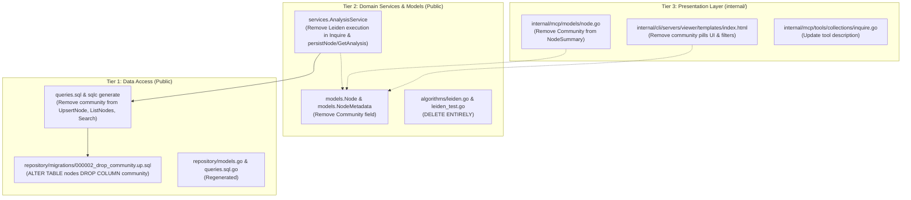
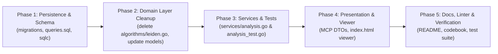

# Implementation Plan: Complete Removal of the Leiden Algorithm

## 1. Executive Summary & Rationale

### 1.1. Context & Background
The Leiden algorithm was originally introduced into `go-bibx` to perform community detection (clustering) on citation networks generated during bibliographic inquiry (`bibx inquire` / MCP `inquire`). The intent was to partition articles into thematic communities alongside the Tree of Science (ToS) SAP classification (`root`, `trunk`, `leaf`).

### 1.2. Why Leiden is Being Removed
In practice, community detection via Leiden has proven to add negligible utility to `bibx` while introducing significant maintenance and computational overhead:
1. **Redundancy with Tree of Science Hierarchy**:
   `bibx` users and downstream agentic workflows categorize literature along developmental and structural trajectories using SAP scoring (seminal roots, structural trunks, frontier leaves). Partitioning nodes into arbitrary modularity clusters adds little semantic value on top of the ToS framework.
2. **Cluster Instability on Sparse Literature Subgraphs**:
   Academic citation subgraphs returned from OpenAlex queries (typically 50–500 works) are often sparse and scale-free. The Leiden modularity optimization frequently collapses into trivial singleton partitions or uninformative mega-clusters without extensive dataset-specific tuning of resolution parameters ($\gamma$, $\theta$).
3. **Execution & Memory Overhead**:
   During every `AnalysisService.Inquire` call, `bibx` currently:
   - Converts the directed acyclic citation graph into an undirected graph (`graphs.Undirected`).
   - Instantiates an iterative partition solver allocating multiple vertex mappings and queue arrays.
   - Executes node moves, partition refinement, graph aggregation, and normalization passes.
   Removing this pipeline eliminates substantial CPU time and heap allocations during collection ingestion.
4. **Architectural & Schema Clutter**:
   The `community` field is propagated through SQLite storage, `sqlc` queries, domain models, MCP DTOs, and the interactive D3 web viewer. Removing it simplifies the entire codebase stack.

---

## 2. Architectural Impact & Tier Breakdown (ADR-001)

Per [ADR-001](file:///home/oscar/Code/coreofscience/go-bibx/docs/adrs/ADR-001-adopting-three-tier-architecture.md), `go-bibx` follows a strict Three-Tier Architecture. The removal of the Leiden algorithm touches all three tiers in a clean, vertical slice:



---

## 3. Scope of Changes by Layer

### 3.1. Tier 1: Data Access & Persistence ([`repository/`](file:///home/oscar/Code/coreofscience/go-bibx/repository) & [`queries.sql`](file:///home/oscar/Code/coreofscience/go-bibx/queries.sql))

#### 3.1.1. Schema Migration
Create a new sequential migration pair using `golang-migrate`:
- **[`000002_drop_community.up.sql`](file:///home/oscar/Code/coreofscience/go-bibx/repository/migrations/000002_drop_community.up.sql)**:
  ```sql
  ALTER TABLE nodes DROP COLUMN community;
  ```
- **[`000002_drop_community.down.sql`](file:///home/oscar/Code/coreofscience/go-bibx/repository/migrations/000002_drop_community.down.sql)**:
  ```sql
  ALTER TABLE nodes ADD COLUMN community INTEGER NOT NULL DEFAULT 0;
  ```

> [!NOTE]
> Modern SQLite (3.35.0+) natively supports `ALTER TABLE ... DROP COLUMN`. No table recreation or data copying is required, and neither indexes nor foreign keys reference the `community` column.

#### 3.1.2. SQL Queries ([`queries.sql`](file:///home/oscar/Code/coreofscience/go-bibx/queries.sql))
1. **`UpsertNode`**: Remove `community` from target columns, values list, and `ON CONFLICT` update clause:
   ```sql
   -- name: UpsertNode :one
   INSERT INTO nodes (
       id,
       collection_id,
       article_id,
       category,
       rootness,
       trunkness,
       leafness
   ) VALUES (?, ?, ?, ?, ?, ?, ?)
   ON CONFLICT(collection_id, article_id) DO UPDATE SET
       category=excluded.category,
       rootness=excluded.rootness,
       trunkness=excluded.trunkness,
       leafness=excluded.leafness
   RETURNING id;
   ```
2. **`ListNodes`**: Remove `n.community` from select list:
   ```sql
   -- name: ListNodes :many
   SELECT
       n.id, n.category, n.rootness, n.trunkness, n.leafness,
       a.id, a.label, a.title, a.journal, a.year, a.volume, a.issue, a.page,
       a.doi, a.permalink, a.times_cited, a.abstract, a.rich,
       a.authors, a.keywords, a.ids
   FROM nodes n
   JOIN articles a ON a.id = n.article_id
   WHERE n.collection_id = ?;
   ```
3. **`Search`**: Remove `n.community` from select list:
   ```sql
   -- name: Search :many
   SELECT
       n.id, n.category, n.rootness, n.trunkness, n.leafness,
       a.id, a.label, a.title, a.journal, a.year, a.volume, a.issue, a.page,
       a.doi, a.permalink, a.times_cited, a.abstract, a.rich,
       a.authors, a.keywords, a.ids
   FROM articles_fts(?) fts
   JOIN articles a ON a.rowid = fts.rowid
   JOIN nodes n ON n.article_id = a.id
   WHERE n.collection_id = ?
   ORDER BY bm25(articles_fts)
   LIMIT ?;
   ```

#### 3.1.3. Code Generation (`sqlc generate`)
Regenerate Go persistence code via `sqlc generate`:
- Updates [`models.go`](file:///home/oscar/Code/coreofscience/go-bibx/repository/models.go) (removes `Community int64` from `Node`).
- Updates [`queries.sql.go`](file:///home/oscar/Code/coreofscience/go-bibx/repository/queries.sql.go) (removes `Community` from `UpsertNodeParams`, `ListNodesRow`, and `SearchRow`).

#### 3.1.4. Repository Tests ([`sqlite_test.go`](file:///home/oscar/Code/coreofscience/go-bibx/repository/sqlite_test.go))
- Update `TestMigrate_RunsMigrations` and `TestOpenAndMigrateSQLite` schema migration version assertions from `assert.Equal(t, 1, version)` to `assert.Equal(t, 2, version)`.

---

### 3.2. Tier 2: Domain Services & Models

#### 3.2.1. Algorithms Package ([`algorithms/`](file:///home/oscar/Code/coreofscience/go-bibx/algorithms))
- **[DELETE]** [`leiden.go`](file:///home/oscar/Code/coreofscience/go-bibx/algorithms/leiden.go) (500+ lines: `Leiden[K]`, `WithGamma`, `WithTheta`, `NewLeiden`, partition methods).
- **[DELETE]** [`leiden_test.go`](file:///home/oscar/Code/coreofscience/go-bibx/algorithms/leiden_test.go) (all unit tests and benchmarks for Leiden).

#### 3.2.2. Core Models ([`analysis.go`](file:///home/oscar/Code/coreofscience/go-bibx/models/analysis.go))
- In [`models.Node`](file:///home/oscar/Code/coreofscience/go-bibx/models/analysis.go#L36-L44):
  - Remove `Community int json:"community"` field.
  - Update doc comment to reflect Tree of Science score attributes only.
- In [`models.NodeMetadata`](file:///home/oscar/Code/coreofscience/go-bibx/models/analysis.go#L48-L68):
  - Remove `Community int yaml:"community"` field.
- In [`(*Node).Metadata()`](file:///home/oscar/Code/coreofscience/go-bibx/models/analysis.go#L71-L105):
  - Remove `Community: n.Community` assignment in both the nil-article and populated-article returns.

#### 3.2.3. Analysis Service ([`analysis.go`](file:///home/oscar/Code/coreofscience/go-bibx/services/analysis.go))
1. **Imports**:
   - Remove unused `"github.com/coreofscience/go-bibx/internal/graphs"`.
2. **`Inquire`**:
   - Delete the entire Leiden processing block:
     ```go
     // Remove:
     slog.InfoContext(ctx, "applying leiden algorithm")
     citationGraph, err := analysis.CitationGraph()
     ...
     communities := algorithms.NewLeiden(undirectedGraph).Run()
     for _, node := range analysis.Nodes {
         node.Community = communities[node.ID]
     }
     ```
3. **`GetAnalysis`**:
   - Remove `Community: int(r.Community)` when mapping `nodeRows` to `*models.Node`.
4. **`persistNode`**:
   - Remove `Community: int64(node.Community)` from `repository.UpsertNodeParams`.
5. **Documentation**:
   - Update docstrings on `AnalysisService` and `Inquire` to remove references to Leiden and community detection.

#### 3.2.4. Service Tests ([`analysis_test.go`](file:///home/oscar/Code/coreofscience/go-bibx/services/analysis_test.go))
- Remove `Community: 1` and `Community: 2` fields from node test fixtures across all test cases (`TestAnalysisService_StoreAndGetAnalysis`, `TestAnalysisService_Search`, etc.).

---

### 3.3. Tier 3: Presentation Layer (`internal/`)

#### 3.3.1. MCP Server Models & Tools ([`internal/mcp/`](file:///home/oscar/Code/coreofscience/go-bibx/internal/mcp))
1. **[`internal/mcp/models/node.go`](file:///home/oscar/Code/coreofscience/go-bibx/internal/mcp/models/node.go)**:
   - Remove `Community int json:"community"` from `NodeSummary`.
   - Remove `Community: n.Community` in `NewNodeSummaryFromModel`.
2. **[`internal/mcp/tools/collections/inquire.go`](file:///home/oscar/Code/coreofscience/go-bibx/internal/mcp/tools/collections/inquire.go)**:
   - Update tool description string:
     ```go
     - Description: "fetch literature from OpenAlex for a research topic, run network algorithms (SAP, Leiden), and store the resulting collection",
     + Description: "fetch literature from OpenAlex for a research topic, run network algorithms (SAP), and store the resulting collection",
     ```
3. **[`internal/mcp/tools/analysis/search_test.go`](file:///home/oscar/Code/coreofscience/go-bibx/internal/mcp/tools/analysis/search_test.go)**:
   - Remove `Community: 1` from `mockAnalysis.Nodes`.

#### 3.3.2. Viewer Template ([`index.html`](file:///home/oscar/Code/coreofscience/go-bibx/internal/cli/servers/viewer/templates/index.html))
1. **CSS Styles**:
   - Remove all `#community-selector-container`, `.community-label`, `.community-pill`, `.community-pill:hover`, `.community-pill.active`, and `.community-pill.active:hover` style rules.
2. **State & Filtering Logic**:
   - Remove `let selectedCommunity = null;`.
   - In `updateSidebar()`:
     - Remove the `if (selectedCommunity !== null) { nodes = nodes.filter(...) }` block.
     - Remove the fallback ternary `"No selected nodes in this community."`.
   - Remove the entire community selector initialization block (lines 773–849):
     - `const communities = Array.from(...)`
     - `function updateCommunityFilter() { ... }`
     - `if (communities.length > 1) { ... }`
   - Node opacity and link stroke opacity will retain their natural defaults (`opacity: 1`, `stroke-opacity: 0.6`) without requiring community filtering callbacks.

---

### 3.4. Miscellaneous & Documentation

#### 3.4.1. Spelling & Codebook ([`codebook.toml`](file:///home/oscar/Code/coreofscience/go-bibx/codebook.toml))
- Remove `"evc"` from `codebook.toml` (was only used for the Leiden modularity variance term `evc`).

#### 3.4.2. Repository Documentation
- **[`README.md`](file:///home/oscar/Code/coreofscience/go-bibx/README.md)**:
  - Update line 28: Remove "and community detection algorithms".
  - Remove line 33 bullet point: `- **Community Detection**: High-performance Leiden algorithm for detecting thematic clusters in citation networks.`.
  - Update line 70: "compute Tree of Science metrics and Leiden communities" -> "compute Tree of Science metrics".
- **[`ADR-001`](file:///home/oscar/Code/coreofscience/go-bibx/docs/adrs/ADR-001-adopting-three-tier-architecture.md)**:
  - Keep ADR-001 context intact as historical record, but add a brief note or update references if needed.

---

## 4. Implementation Steps & Sequencing



### Phase 1: Database Schema & Query Generation
1. Write `repository/migrations/000002_drop_community.up.sql` and `000002_drop_community.down.sql`.
2. Update `queries.sql` (`UpsertNode`, `ListNodes`, `Search`).
3. Run `sqlc generate`.
4. Update `repository/sqlite_test.go` migration version checks to `2`.
5. Run `go test ./repository/...` to verify migration execution and query compilation.

### Phase 2: Domain Models & Algorithm Package Deletion
1. Delete `algorithms/leiden.go` and `algorithms/leiden_test.go`.
2. Remove `Community` from `models.Node` and `models.NodeMetadata` in `models/analysis.go`.
3. Update `(*Node).Metadata()` in `models/analysis.go`.
4. Run `go test ./models/...` and `go test ./algorithms/...`.

### Phase 3: Service Layer Refactoring
1. Edit `services/analysis.go`:
   - Remove Leiden execution block in `Inquire`.
   - Remove `"github.com/coreofscience/go-bibx/internal/graphs"` from imports.
   - Remove `Community` mapping from `GetAnalysis` and `persistNode`.
   - Update docstrings.
2. Edit `services/analysis_test.go`:
   - Remove `Community` fields from all mock node literals.
3. Run `go test -v ./services/...`.

### Phase 4: Presentation Layer (MCP & Viewer)
1. Update `internal/mcp/models/node.go` (`NodeSummary`).
2. Update `internal/mcp/tools/collections/inquire.go` tool description.
3. Update `internal/mcp/tools/analysis/search_test.go`.
4. Edit `internal/cli/servers/viewer/templates/index.html`:
   - Remove CSS community styles.
   - Remove `selectedCommunity` state and community selector DOM builder.
   - Simplify `updateSidebar()`.
5. Run `go test ./internal/mcp/...` and `go test ./internal/cli/...`.

### Phase 5: Documentation & Quality Gate
1. Remove `evc` from `codebook.toml`.
2. Update `README.md` to remove references to the Leiden algorithm and community detection.
3. Run full verification suite:
   - `go test -v ./...`
   - `golangci-lint run`
   - Test CLI command `bibx inquire` and `bibx view` locally with a test collection.

---

## 5. Verification & Testing Matrix

| Component | Target File | Verification Criteria | Command |
| :--- | :--- | :--- | :--- |
| **Database Migrations** | `repository/migrations/000002_drop_community.*.sql` | Migration version 2 applies cleanly on fresh and existing databases; down migration restores column | `go test -v ./repository` |
| **sqlc Generation** | `repository/queries.sql.go` | Go structs compile without `Community` field; upsert and selects succeed | `sqlc generate && go build ./repository` |
| **Algorithms** | `algorithms/` | Remaining algorithms (`sap`, `steiner`) compile and pass all tests without Leiden | `go test -v ./algorithms` |
| **Domain Models** | `models/analysis.go` | JSON and YAML marshaling/unmarshaling of `Node` and `NodeMetadata` pass without `community` | `go test -v ./models` |
| **Analysis Service** | `services/analysis.go` | `Inquire` pipeline executes without Leiden step; collection persistence and retrieval works | `go test -v ./services` |
| **MCP Server** | `internal/mcp/` | `NodeSummary` schema does not contain `community`; inquire and search tools operate normally | `go test -v ./internal/mcp/...` |
| **CLI Viewer Server** | `internal/cli/servers/viewer/` | Viewer endpoints serve valid HTML/JSON without Javascript errors or undefined community references | `go test -v ./internal/cli/servers/viewer` |
| **Full Project Build & Lint** | Entire codebase | Zero compiler errors, zero lint warnings, zero leftover references to `leiden` | `go test ./... && golangci-lint run` |

---

## 6. Risk Assessment & Mitigations

| Risk | Impact | Mitigation Strategy |
| :--- | :--- | :--- |
| **Existing User Databases** | Users with existing `bibx.db` files will encounter schema differences if migrations fail | Migration `000002_drop_community.up.sql` uses non-destructive SQLite `ALTER TABLE DROP COLUMN`, preserving all existing article and collection data intact. |
| **Cached JSON Collections** | Existing serialized `collection.json.gz` files may have `"community": <int>` keys | Go's `encoding/json` default behavior ignores unrecognized fields during unmarshaling into `models.Node`, providing backward compatibility for old collection files. |
| **MCP API Breaking Changes** | Clients relying on `community` in `NodeSummary` JSON schema | In practice, MCP agents use Tree of Science categories (`root`, `trunk`, `leaf`) and semantic relevance. Removing the unused field tightens token utilization in agent contexts. |
| **Regression in Search / Steiner Reduction** | `analysis.CitationGraph()` might be accidentally deleted when removing Leiden | Confirm that `CitationGraph()` remains implemented on `models.Analysis` and is preserved for `services.AnalysisService.Search` (which requires it for `NewPseudoSteiner`). |
