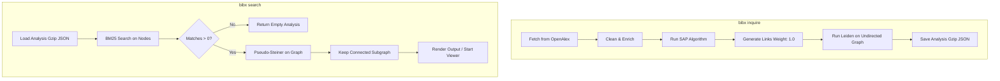

# Implementation Plan: Remove Ollama Integration & Add Keyword Search

## Goal Description

The objective is to remove all dependencies on Ollama and local text
embeddings from go-bibx, replacing semantic search with a fast, self-contained
keyword search based on the BM25 (Best Matching 25) ranking algorithm with
field weighting.

This transition will:

1. Make go-bibx fully self-contained and offline-first, removing the
   requirement for an Ollama daemon and local model downloads (~300MB+).
2. Dramatically speed up bibx inquire by avoiding batch embedding HTTP
   requests during data ingestion.
3. Remove github.com/ollama/ollama from go.mod and clean up obsolete packages
   (cli/clients/embeddings, cli/commands/setup, internal/vector,
   internal/texter).
4. Retain the powerful pseudo-Steiner graph reduction in bibx search, where
   the top matching papers found via BM25 search serve as terminals to
   construct the connected citation subgraph.

---

## Confirmed Design Decisions

- bibx setup Command: Completely remove bibx setup from the CLI, codebook
  dictionary, documentation, and agent templates.
- Search Algorithm: Use BM25 with field weighting (Title, Keywords, Abstract,
  Authors) and phrase boost.
- Empty Search Results: When a search query matches zero articles, bibx search
  gracefully returns an empty analysis (&models.Analysis{}).
- Citation Edge Weights & Leiden: Link weights in the citation graph will
  default to 1.0 (indicating citation connection), and Leiden community
  detection will run directly on the unweighted citation graph.
- Node Embedding Field: Removed from models.Node. Older files containing
  embedding data will continue to load without errors because standard JSON
  unmarshaling ignores unrecognized fields.

---

## Detailed Design: BM25 (Best Matching 25)

### What is BM25?

BM25 is a probabilistic information retrieval ranking function widely
regarded as the gold standard for full-text search (used by engines like
Lucene, Elasticsearch, and Solr).

Unlike basic keyword matching (which simply counts word occurrences), BM25
solves two key search problems:
jkj,wk
1. Term Frequency Saturation: In naive term counting, an article mentioning
   "graph" 20 times scores 20x higher than one mentioning it once. In BM25,
   the benefit of additional occurrences tapers off (controlled by parameter
   k1).
2. Document Length Normalization: Longer abstracts naturally contain more
   words. BM25 penalizes overly long documents so they don't dominate shorter,
   more focused papers (controlled by parameter b).
3. Inverse Document Frequency (IDF): Words that appear in almost every paper
   (e.g. "research", "study", "analysis") receive near-zero weight, whereas
   rare domain-specific keywords (e.g. "qubit", "leiden", "eigenvector")
   receive high weight.

### Mathematical Formulation

Given a query Q consisting of terms q1, q2, ..., qn, the score of an article
document D is:

$$
\text{Score}(D, Q) = \sum_{i=1}^n \text{IDF}(q_i) \cdot \frac{f(q_i, D) \cdot
(k_1 + 1)}{f(q_i, D) + k_1 \cdot \left(1 - b + b \cdot
\frac{|D|}{\text{avgdl}}\right)} + \text{Bonus}_{\text{phrase}}(D, Q)
$$

Where:

- f(qi, D): Weighted term frequency of term qi in document D:
  f(qi, D) = 3.0 * f_title + 2.0 * f_keywords + 1.0 * f_abstract + 2.0 *
  f_authors
- |D|: Document length (total tokens in document).
- avgdl: Average document length across all articles in the analysis
  collection.
- k1: Term frequency saturation parameter (standard value: 1.2).
- b: Document length normalization parameter (standard value: 0.75).
- IDF(qi): Robertson-Spärck Jones / Lucene IDF:
  IDF(qi) = ln(1 + (N - n(qi) + 0.5) / (n(qi) + 0.5))
  where N is total articles and n(qi) is the number of articles containing qi.
- Bonus_phrase(D, Q): Extra boost (+2.0) if the query appears verbatim as a
  substring in the title.

Documents with Score <= 0 (no query terms present) are omitted from search
results.

---

## Proposed Changes



---

### Component: internal/search (Keyword Search Engine)

#### [NEW] internal/search/bm25.go

Create a clean, self-contained BM25 search package:
- Tokenizer: lowercase, strip punctuation (unicode.IsPunct), split by
  whitespace.
- Support multi-field documents (Title, Keywords, Abstract, Authors) with
  configurable field weights.
- Compute IDF dynamically over the collection.
- Filter out non-matching documents (score <= 0).
- Sort top matches by score descending and return up to limit items.

#### [NEW] internal/search/bm25_test.go

Comprehensive unit tests:
- Exact title match ranking.
- Multi-term queries matching both vs single terms.
- Rare term vs common term IDF weighting.
- Field weight validation (title matches outscoring abstract mentions).
- Phrase boost test.
- Edge cases: empty query, zero matches, special characters, case
  insensitivity.

---

### Component: models (Analysis & Search)

#### [MODIFY] models/analysis.go

- Remove Embedding []float32 from Node.
- Update Analysis.Search signature:
  func (a *Analysis) Search(query string, limit int) ([]*Node, error)
- Implement Search by transforming a.Nodes into searchable documents and
  calling internal/search.BM25Search.

#### [MODIFY] models/analysis_test.go

- Update tests for Analysis.Search with string queries and mock articles.
- Remove vector embedding tests.

---

### Component: cli/services (Analysis & Store)

#### [MODIFY] cli/services/analysis.go

- Remove embeddingClient and texter from OpenAlexAnalysisService.
- Simplify constructor:
  NewOpenAlexAnalysisService(openalexClient, analysisRepo)
- Update NewOpenAlexAnalysisServiceFromConfig: remove Ollama client creation.
- In Store:
  - Remove calls to EmbedMany.
  - Assign Weight: 1.0 to links.
  - Run Leiden directly on undirectedGraph (remove graphs.InvertWeight).
- In Search:
  - Remove query embedding.
  - Call analysis.Search(query, limit).
  - Return early with &models.Analysis{}, nil if len(searchResults) == 0.

#### [MODIFY] cli/services/analysis_test.go

- Remove mockEmbeddingsClient.
- Update tests for Store, Query, and Search to verify analysis creation and
  keyword-based search.

---

### Component: Clean up Obsolete Packages & Dependencies

#### [DELETE] cli/clients/embeddings/client.go

- Delete package cli/clients/embeddings.

#### [DELETE] cli/commands/setup/setup.go

- Delete package cli/commands/setup.

#### [DELETE] internal/vector/vector.go and internal/vector/vector_test.go

- Delete package internal/vector.

#### [DELETE] internal/texter/article.go

- Delete package internal/texter.

#### [MODIFY] cli/commands/commands.go

- Remove setup.New() registration.

#### [MODIFY] go.mod and go.sum

- Remove github.com/ollama/ollama dependency and run go mod tidy.

---

### Component: CLI Commands

#### [MODIFY] cli/commands/search/search.go

- Update usage string from:
  "Perform a semantic search on the bibx collection"
  to:
  "Perform a keyword search on the bibx collection".

---

### Component: Documentation & Agent Templates

#### [MODIFY] README.md

- Update search description to keyword search.
- Remove notes about Ollama prerequisites and ./bibx setup.
- Update search usage examples.

#### [MODIFY] CONTRIBUTING.md

- Remove Ollama from prerequisites and setup instructions.

#### [MODIFY] cli/repos/templates/AGENTS.md

- Remove Ollama notes from search instructions.

#### [MODIFY] cli/repos/templates/.agents/skills/bibx-inquire/SKILL.md

- Remove Ollama troubleshooting advice.

#### [MODIFY] cli/repos/templates/.agents/skills/bibx-search/SKILL.md

- Update description to keyword search.
- Remove Ollama server and bibx setup prerequisites and troubleshooting.

---

## Verification Plan

### Automated Tests

Run full test suite and linters to verify zero regressions:

```bash
go test -v ./...
go mod tidy
git diff go.mod
```

Verify specific packages:

```bash
go test -v ./internal/search/...
go test -v ./models/...
go test -v ./cli/services/...
```

### Manual Verification

1. Build binary:
   ```bash
   go build -o bibx ./cmd/bibx
   ```
2. Run test inquiry (OpenAlex API call without Ollama running):
   ```bash
   ./bibx inquire "graph neural networks" --limit 20 --force \
     --root ./scratch/test_run
   ```
   Confirm that .bibx/analysis.json.gz is generated quickly without any
   connection to Ollama.
3. Test search query:
   ```bash
   ./bibx search "attention" --root ./scratch/test_run --format markdown
   ```
   Confirm that matching articles are found and connected via pseudo-Steiner
   graph reduction.
4. Verify non-matching query returns empty result cleanly:
   ```bash
   ./bibx search "nonexistenttermxyz" --root ./scratch/test_run --format simple
   ```
