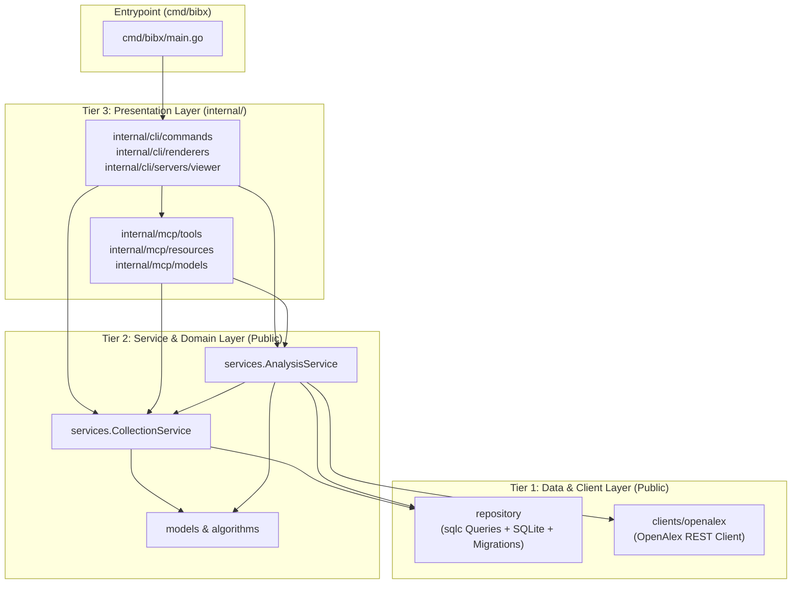

# Implementation Plan: Three-Tier Architecture Migration

## Goal Description

Refactor `go-bibx` into a clean, well-bounded **3-tier architecture** now that the project serves both a CLI and an MCP server.

Currently, responsibilities and package visibility are fragmented:
- External API clients (`cli/clients/openalex`) and core business services (`cli/services`) are nested under `cli/`, even though `mcp/` imports and uses them directly.
- Persistence logic is split between `repository/` (sqlc-generated queries) and `storage/` (`storage.Store` interface, `storage.SQLiteStore` implementation, and `storage.Collection` model), creating an extra intermediary layer between `repository` and `services`.
- Presentation layers (`cli/` and `mcp/`) sit at the top-level root as public packages despite being internal application entrypoints.

This migration establishes a strict 3-tier architecture where **Tier 1** and **Tier 2** are public packages and **Tier 3** lives under `internal/`:

1. **Tier 1 — Data Access & External Clients (Public):**
   - `repository/`: SQLite connection lifecycle, embedded schema migrations, and `sqlc`-generated database queries (`*repository.Queries`).
   - `clients/openalex/`: OpenAlex REST API client.
2. **Tier 2 — Domain Services (Public):**
   - `services/`: Replaces `storage.Store` and `cli/services`, combining persistence mapping, collection management, OpenAlex ingestion, and graph analysis (`CollectionService` and `AnalysisService`).
   - Supported by public domain models (`models/`) and graph algorithms (`algorithms/`).
3. **Tier 3 — Presentation & Delivery (Internal):**
   - `internal/cli/`: CLI commands, output renderers, and interactive web viewer server.
   - `internal/mcp/`: MCP server tools, resources, and schema-safe DTO models.

---

## Confirmed Design Decisions

- **Layer 1 (`repository` & `clients/openalex`) — Public:**
  - `storage/migrations/` moves to `repository/migrations/`.
  - `repository/sqlite.go` owns opening/configuring the `*sql.DB` (WAL mode, foreign keys, parent directory creation) and running embedded migrations via `repository.OpenSQLite(dbPath)` and `repository.Migrate(db)`.
  - `cli/clients/openalex` moves to `clients/openalex`.
- **Layer 2 (`services`) — Public:**
  - `storage/` (`storage.Store` and `storage.SQLiteStore`) is removed. Its SQLite query execution and entity mapping move directly into `services/`, backed by `*sql.DB` and `*repository.Queries`.
  - Split into two cohesive services in `services/`:
    1. **`CollectionService`**: Manages collection lifecycle and lookup (`List`, `FindByID`, `FindByName`, `FindByHash`, `Resolve`, `Create`, `UpdateName`, `Delete`).
    2. **`AnalysisService`**: Manages literature inquiry, graph algorithms (SAP, Leiden, Pseudo-Steiner), and analysis persistence/queries (`Inquire`, `Load`, `QueryCategory`, `Search`).
  - `storage.Collection` moves to `models/` (or `services/`) as `models.CollectionRecord` (or `services.Collection`) alongside `ErrCollectionNotFound` and `ErrCollectionExists`, keeping `models.Collection` (the in-memory citation graph builder) distinct or clearly named.
- **Layer 3 (`internal/cli` & `internal/mcp`) — Internal:**
  - `cli/commands`, `cli/renderers`, and `cli/servers/viewer` move under `internal/cli/`.
  - `mcp/` (`mcp/models`, `mcp/resources`, `mcp/tools`, `mcp/test`) moves under `internal/mcp/`.
  - Both CLI commands and MCP tools/resources depend exclusively on Tier 2 (`services` and `models`), never directly on `storage` or `repository`.

---

## Architecture Overview



### Target Directory Structure

```text
.
├── algorithms/                  # Public domain graph algorithms (SAP, Leiden, Steiner)
├── clients/                     # [Tier 1 - Public] External API clients
│   └── openalex/                # Moved from cli/clients/openalex
├── cmd/
│   └── bibx/
│       └── main.go              # Entrypoint importing internal/cli/commands
├── models/                      # Public domain models (Article, Analysis, Collection, etc.)
├── repository/                  # [Tier 1 - Public] Database layer & sqlc generated code
│   ├── migrations/              # Moved from storage/migrations
│   ├── db.go                    # Generated by sqlc
│   ├── models.go                # Generated by sqlc
│   ├── queries.sql.go           # Generated by sqlc
│   ├── sqlite.go                # SQLite DB initialization & migration runner
│   └── sqlite_test.go           # Database & migration tests
├── services/                    # [Tier 2 - Public] Business logic & persistence orchestration
│   ├── collection.go            # CollectionService (replaces storage.Store collection methods)
│   ├── collection_test.go
│   ├── analysis.go              # AnalysisService (combines analysis storage + OpenAlex inquiry)
│   └── analysis_test.go
└── internal/                    # [Tier 3 & Internal Utilities]
    ├── cli/                     # Moved from cli/
    │   ├── commands/
    │   ├── renderers/
    │   └── servers/viewer/
    ├── mcp/                     # Moved from mcp/
    │   ├── models/
    │   ├── resources/
    │   ├── test/
    │   └── tools/
    ├── collections/             # Internal generic data structures (Set, Queue)
    ├── graphs/                  # Internal graph helper functions
    ├── mocks/                   # Auto-generated testify mocks
    ├── union/                   # Disjoint-set union
    └── utils/                   # Internal utilities
```

---

## Detailed Design

### 1. Tier 1: `repository` and `clients/openalex`

#### `repository` Package

- **Migrations**: Move `storage/migrations/*.sql` to `repository/migrations/*.sql`.
- **Update `sqlc.yaml`**: Point `schema` to `./repository/migrations`.
- **Database Initialization (`repository/sqlite.go`)**:
  - `OpenSQLite(path string) (*sql.DB, error)`: Handles `file:` URI parsing, creates parent directories (`0755`), opens the `modernc.org/sqlite` connection, sets `PRAGMA journal_mode=WAL; PRAGMA foreign_keys=ON;`, and runs embedded migrations.
  - `Migrate(db *sql.DB) error`: Runs embedded SQL migrations using `golang-migrate`.

#### `clients/openalex` Package

- Move `cli/clients/openalex/*` to `clients/openalex/*`.
- Package name remains `openalex` (`github.com/coreofscience/go-bibx/clients/openalex`).
- No functional changes required; `Client` interface and `RestyClient` remain public.

---

### 2. Tier 2: `services` Package

The `services` package replaces `storage/store.go`, `storage/sqlite.go`, and `cli/services/analysis.go`.

#### Domain Types & Errors (`services/collection.go`)

- Errors:
  - `ErrCollectionNotFound = errors.New("collection not found")`
  - `ErrCollectionExists = errors.New("collection already exists")`
- Types:
  - `Collection`: Moves from `storage.Collection` to `services.Collection` (with `ID`, `QueryHash`, `Query`, `ResultLimit`, `Parameters`, `Name`, `ArticleCount`, `CreatedAt`, `UpdatedAt`).
- Query Normalization & Hashing:
  - `NormalizeQuery(q string) string`
  - `ComputeQueryHash(query string, limit int) [32]byte`

#### `CollectionService` (`services/collection.go`)

```go
type CollectionService interface {
	FindByHash(ctx context.Context, hash [32]byte) (*Collection, error)
	FindByID(ctx context.Context, id uuid.UUID) (*Collection, error)
	FindByName(ctx context.Context, name string) (*Collection, error)
	Resolve(ctx context.Context, target string) (*Collection, error)
	List(ctx context.Context) ([]*Collection, error)
	Create(ctx context.Context, col *Collection) error
	UpdateName(ctx context.Context, id uuid.UUID, name *string) error
	Delete(ctx context.Context, id uuid.UUID) error
}
```

- Concrete implementation `SQLiteCollectionService` wraps `*repository.Queries`.
- `NewCollectionService(db repository.DBTX) *SQLiteCollectionService` (or `NewCollectionServiceWithQueries(q *repository.Queries)`).
- `Resolve(ctx, target)` encapsulates the target resolution logic previously in `storage.ResolveCollection(ctx, store, target)` (empty target returns latest collection, valid UUID checks `FindByID` then falls back to `FindByName`).

#### `AnalysisService` (`services/analysis.go`)

Combines the graph persistence/query methods from `storage.SQLiteStore` (`StoreAnalysis`, `LoadAnalysis`, `QueryCategory`, `Search`) and the orchestration logic from `cli/services.OpenAlexAnalysisService`:

```go
type InquireOptions struct {
	Force bool
	Name  string
}

type InquireResult struct {
	Collection *Collection
	IsNew      bool
}

type AnalysisService interface {
	Inquire(ctx context.Context, query string, limit int, opts InquireOptions) (*InquireResult, error)
	StoreAnalysis(ctx context.Context, collectionID uuid.UUID, a *models.Analysis) error
	LoadAnalysis(ctx context.Context, target string) (*models.Analysis, *Collection, error)
	LoadAnalysisByID(ctx context.Context, collectionID uuid.UUID) (*models.Analysis, error)
	Query(ctx context.Context, category string, limit int, target string) ([]*models.Result, *Collection, error)
	Search(ctx context.Context, query string, limit int, target string) (*models.Analysis, *Collection, error)
}
```

- Concrete implementation `OpenAlexAnalysisService` holds:
  - `db *sql.DB` (for transactional `BeginTx` in `StoreAnalysis`)
  - `queries *repository.Queries`
  - `collections CollectionService`
  - `openalexClient openalex.Client`
- Constructors:
  - `NewAnalysisService(db *sql.DB, oaClient openalex.Client, collections CollectionService) *OpenAlexAnalysisService`
  - Helper factory `OpenServices(dbPath string) (*sql.DB, *SQLiteCollectionService, *OpenAlexAnalysisService, error)` (or a lightweight container/provider) to avoid boilerplate in CLI commands and MCP server startup.
- Notice how passing `target string` (or resolving via `s.collections.Resolve(ctx, target)`) inside `AnalysisService.Query`, `AnalysisService.Search`, and `AnalysisService.LoadAnalysis` eliminates duplicated collection resolution code across `cli/commands/query`, `cli/commands/search`, `cli/commands/view`, `mcp/tools/analysis/tos`, and `mcp/tools/analysis/search`.

---

### 3. Tier 3: `internal/cli` and `internal/mcp`

#### `internal/cli`

- Move `cli/commands/...` -> `internal/cli/commands/...`
- Move `cli/renderers/...` -> `internal/cli/renderers/...`
- Move `cli/servers/viewer/...` -> `internal/cli/servers/viewer/...`
- Update each CLI command action:
  - `collection list`, `collection show`, `collection delete`: Open DB via `repository.OpenSQLite(dbPath)` and use `services.NewCollectionService(db)`.
  - `inquire`, `query`, `search`, `view`: Open DB via `repository.OpenSQLite(dbPath)` and use `services.NewAnalysisService(...)`.
  - `mcp`: Open DB via `repository.OpenSQLite(dbPath)`, instantiate `CollectionService` and `AnalysisService`, and register MCP tools and resources.

#### `internal/mcp`

- Move `mcp/models/...` -> `internal/mcp/models/...`
  - Update `NewCollectionSummaryFromModel` to accept `*services.Collection`.
- Move `mcp/resources/...` -> `internal/mcp/resources/...`
  - `resources.Register(server, collectionService)`
  - `collections.Summary` depends on `services.CollectionService` (instead of `storage.Store`).
- Move `mcp/tools/...` -> `internal/mcp/tools/...`
  - `tools.Register(server, collectionService, analysisService)`
  - `collections.List` and `collections.Show` depend on `services.CollectionService`.
  - `collections.Inquire`, `analysis.Tos`, and `analysis.Search` depend on `services.AnalysisService` (eliminating the dual `service` + `store` fields in `Tos` and `Search`).
- Move `mcp/test/...` -> `internal/mcp/test/...`

---

## Step-by-Step Migration Plan

### Phase 1: Tier 1 Migration (`repository` & `clients/openalex`)

#### [MOVE] `storage/migrations/*` -> `repository/migrations/*`
- Move `000001_init_schema.up.sql` and `000001_init_schema.down.sql` into `repository/migrations/`.

#### [MODIFY] [sqlc.yaml](file:///home/oscar/Code/coreofscience/go-bibx/sqlc.yaml)
- Update `schema: ./storage/migrations` to `schema: ./repository/migrations`.

#### [NEW] `repository/sqlite.go` & `repository/sqlite_test.go`
- Move `migrationsFS`, `runMigrations` (exported as `Migrate(db *sql.DB) error`), and SQLite connection initialization (`OpenSQLite(path string) (*sql.DB, error)`) from `storage/sqlite.go` into `repository/sqlite.go`.
- Move migration and directory-creation tests (`TestNewSQLiteStore_Migrations`, `TestNewSQLiteStore_CreatesParentDirectories`) from `storage/sqlite_test.go` to `repository/sqlite_test.go`.

#### [MOVE] `cli/clients/openalex/*` -> `clients/openalex/*`
- Move `client.go`, `client_test.go`, and `models.go` to `clients/openalex/`.
- Remove empty `cli/clients/` directory.

---

### Phase 2: Tier 2 Migration (`services` Package)

#### [NEW] `services/collection.go` & `services/collection_test.go`
- Define `Collection`, `ErrCollectionNotFound`, `ErrCollectionExists`, `NormalizeQuery`, `ComputeQueryHash`, `UUIDToBytes`, `ScanUUID`.
- Define `CollectionService` interface and `SQLiteCollectionService` implementation using `*repository.Queries`.
- Implement `FindByHash`, `FindByID`, `FindByName`, `Resolve`, `List`, `Create`, `UpdateName`, and `Delete`.
- Migrate collection CRUD, query hash, and resolution tests from `storage/sqlite_test.go` and `storage/store_test.go` to `services/collection_test.go`.

#### [NEW] `services/analysis.go` & `services/analysis_test.go`
- Move `cli/services/analysis.go` to `services/analysis.go`.
- Merge `StoreAnalysis`, `LoadAnalysis` / `LoadAnalysisByID`, `QueryCategory`, `Search` (FTS5 + Pseudo-Steiner), and article/node/link persistence helpers (`persistNode`, `persistLinks`, `buildArticle`, `cleanFTS5Query`) from `storage/sqlite.go` into `services/analysis.go`.
- Define the `AnalysisService` interface and `OpenAlexAnalysisService` struct.
- Migrate and combine unit and integration tests from `storage/sqlite_test.go` (analysis persistence, FTS5 search, category queries) and `cli/services/analysis_test.go` (OpenAlex inquiry, idempotency, enrichment, re-cleaning) into `services/analysis_test.go`.

#### [DELETE] `storage/` & `cli/services/`
- Delete `storage/store.go`, `storage/store_test.go`, `storage/sqlite.go`, `storage/sqlite_test.go`.
- Delete `cli/services/analysis.go` and `cli/services/analysis_test.go`.

---

### Phase 3: Tier 3 Migration (`internal/cli` & `internal/mcp`)

#### [MOVE] `cli/*` -> `internal/cli/*`
- Move `cli/commands`, `cli/renderers`, and `cli/servers` to `internal/cli/`.
- Remove the top-level `cli/` directory.
- Update imports in [main.go](file:///home/oscar/Code/coreofscience/go-bibx/cmd/bibx/main.go) and across `internal/cli/...`.
- Refactor CLI command handlers (`collection`, `inquire`, `query`, `search`, `view`, `mcp`) to initialize `*sql.DB` via `repository.OpenSQLite` and invoke `services.CollectionService` / `services.AnalysisService`.

#### [MOVE] `mcp/*` -> `internal/mcp/*`
- Move `mcp/models`, `mcp/resources`, `mcp/tools`, and `mcp/test` to `internal/mcp/`.
- Remove the top-level `mcp/` directory.
- Update `internal/mcp/models/collection.go` to reference `*services.Collection`.
- Update `internal/mcp/resources` and `internal/mcp/tools` to accept `services.CollectionService` and `services.AnalysisService` instead of `storage.Store`.
- Simplify `internal/mcp/tools/analysis/tos.go` and `internal/mcp/tools/analysis/search.go` so they only depend on `AnalysisService` (which now resolves collection targets directly).
- Update all MCP tool and resource tests (`*_test.go`) to use service mocks.

---

### Phase 4: Mocks, Tooling & Documentation Cleanup

#### [MODIFY] `internal/mocks/`
- Re-run `mockery` (or update mock packages) to reflect the new package paths:
  - Remove `internal/mocks/storage` and `internal/mocks/cli/...` and `internal/mocks/mcp/...`.
  - Generate mocks for `clients/openalex`, `services` (`CollectionService`, `AnalysisService`), `internal/cli/renderers`, and `internal/mcp/tools/...` as needed.

#### [MODIFY] Documentation
- Update `README.md` or `CONTRIBUTING.md` if any package paths or architecture notes are referenced.

---

## Verification Plan

### Automated Verification

1. **Code Generation & SQLC Check**:
   ```bash
   sqlc generate
   mockery
   ```
2. **Unit & Integration Tests**:
   ```bash
   go test -v -race ./...
   ```
3. **Linter & Formatting**:
   ```bash
   gofmt -s -w ./
   golangci-lint run
   go mod tidy -diff
   ```
4. **Tier Boundary Verification**:
   Verify that Tier 1 and Tier 2 packages have zero imports from `internal/cli` or `internal/mcp`, and that Tier 3 packages do not bypass Tier 2 to call `repository` queries directly:
   ```bash
   go list -f '{{.ImportPath}} -> {{.Imports}}' ./repository/... ./clients/... ./services/...
   ```
